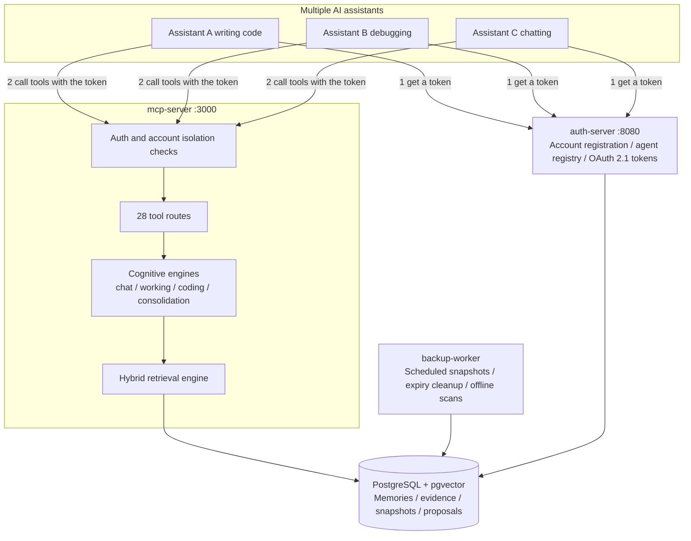
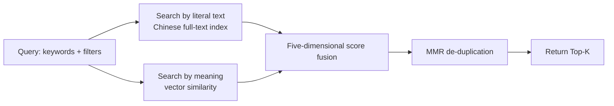

# Memory Hub · 记忆中枢

> **Language / 语言**: [English](README.en.md) · [简体中文](README.md)

**A long-term memory ledger shared by a whole team of AI assistants: it remembers, it retrieves, it keeps things apart, it never loses them.**

[](https://www.rust-lang.org)
[](https://doc.rust-lang.org/edition-guide/rust-2021/index.html)
[](https://github.com/orderye/memory-hub/actions/workflows/ci.yml)
[](https://github.com/orderye/memory-hub/actions/workflows/ci.yml)
[](https://modelcontextprotocol.io/)
[](https://www.postgresql.org/)
[](LICENSE-MIT)

[](https://www.kimi.com/code) [](https://github.com/deepseek-ai/deepseek-harness)

Put plainly: **AI assistants forget everything the moment you close the window. This service stores what is worth remembering so the next session can pick it up.**

On the outside it is a standard MCP server, so Claude Desktop, Cursor, Cline, LangChain and other agent frameworks can connect to it directly.
On the inside it takes care of four things — **storage, backup, consolidation, evolution**.

> **What it deliberately does not do (this matters)**: it does not stuff prompt conventions into your memories, and it does not make reasoning decisions for your agent.
> It only guarantees that "the memory it hands back is real, structured, and backed by evidence". How you use it is your agent's business.

---

## Table of contents

- [1. The problem it solves](#1-the-problem-it-solves)
- [2. The shape of it: three processes + one database](#2-the-shape-of-it-three-processes--one-database)
- [3. Quick start](#3-quick-start)
- [4. How memories are organized](#4-how-memories-are-organized)
- [5. How retrieval works](#5-how-retrieval-works)
- [6. Security and reliability](#6-security-and-reliability)
- [7. The MCP tool surface (28 tools)](#7-the-mcp-tool-surface-28-tools)
- [8. Project layout](#8-project-layout)
- [9. Development, testing and quality gates](#9-development-testing-and-quality-gates)
- [10. Known limitations and what's next](#10-known-limitations-and-whats-next)
- [11. Documentation map](#11-documentation-map)

---

## 1. The problem it solves

The pain of giving agents long-term memory is always in the same handful of places. Here is "the pain" next to "what this service does about it":

| Common pain | What Memory Hub does |
| :--- | :--- |
| **The assistant forgets as soon as the window closes** | Memories live on the server (PostgreSQL), so a new session or a different machine can pick them up |
| **Several assistants each keep their own copy, duplicating and contradicting each other** | The consolidation hub detects duplicates and conflicts on its own; it can merge high-confidence cases automatically and raise proposals for a human to adjudicate |
| **Stale information gets pulled back in as if it were new** | Memories carry a validity window (`valid_from` / `valid_until`). When a new fact supersedes an old one, the old entry is automatically sealed off and retrieval stops returning it |
| **The model invents facts and invents code changes** | Raw material is stored as **append-only evidence** (`memory_evidence`) before anything is distilled. Code changes are only accepted from real Git diffs, never from the model's own account |
| **A trick that works on this machine causes damage on another** | Experience entries carry applicable-environment tags (e.g. `linux`, `k8s`). When the environment does not match, retrieval **warns explicitly and down-weights** |
| **Multi-tenant / multi-user data sees each other** | Accounts are hard sandbox boundaries: even two accounts using the same namespace name see completely separate data (there are tests pinning cross-tenant access at exactly 0) |
| **The memory store gets slow and messy over time** | Keyword + semantic dual-path retrieval, MMR de-duplication of similar hits, and automatic degradation to keyword-only when the vector service is down — the retrieval endpoint never hangs |

### Positioning in one line

Not "yet another agent framework" — only **infrastructure**: a memory foundation that multiple agents can share, that is isolated per account, and that can be backed up and restored.

---

## 2. The shape of it: three processes + one database

| Process | External form | What it owns (by analogy) |
| :--- | :--- | :--- |
| **`mcp-server`** | HTTP `:3000` (endpoint `/mcp`), stdio also supported | The library front desk: takes memory read/write and retrieval requests, exposes 28 MCP tools |
| **`auth-server`** | HTTP `:8080`, with a web console | The gatekeeper and the licensing office: registers accounts and agents, issues tokens (OAuth 2.1) |
| **`backup-worker`** | Long-running background process with cron jobs | The night-shift admin: scheduled backup snapshots, expiry cleanup, offline duplicate and conflict scans |
| **PostgreSQL 15 + pgvector** | Data files | The warehouse itself (local development can swap in pure in-memory mode — it forgets on restart, debug use only) |

All three processes are **stateless**, so you can run several instances of each to absorb load.

> **Two-process shape (optional)**: set `HUB_EMBEDDED_WORKER=1` on `mcp-server` and the
> backup-worker's resident jobs (scheduled backups, expiry/evidence cleanup, integration
> scans) run inside the MCP process with the **same cron and cross-process lease**, shrinking
> the deployment to auth-server + mcp-server. Lite deployments enable it by default; the job
> logic lives in one place (`worker::embedded`), so the standalone process and the embedded
> mode behave identically.



---

## 3. Quick start

### Two deployment shapes: Personal Lite / Production Full

One codebase, one database schema, one backup format — a single setting picks the **default behavior**:

| | Personal Lite | Production Full (default) |
| :--- | :--- | :--- |
| Fits | single machine, one person, a few agents | teams / multi-account / public service |
| Processes | postgres + auth-server + mcp-server (three) | plus a **long-running** backup-worker (four) |
| Embedding | `HUB_EMBED_PROVIDER=off`: no vectors, no outbound calls | `mock` (dev) or `http` (real semantics) |
| Retrieval | keyword-only (FTS + five-signal scoring + `min_score` rejection) | keyword + pgvector semantic recall |
| Consolidation | local rules only (embedding calls stay 0) | same, may opt into `hybrid` |
| Background jobs | embedded in mcp-server (scheduled backups + daily scans; sweeps still manual `--once`) | resident process: cron backups + periodic sweeps + cross-replica lease |
| Security | OAuth 2.1 / ACL / account isolation / backup & restore **all kept** | same |

> **Upgrading changes nothing by default**: `HUB_DEPLOYMENT_PROFILE` defaults to `production`,
> so leaving it unset means today's behavior. Lite is just a different set of defaults
> for the same implementation, not a second codebase.

### Option A: one-command Docker Compose (recommended)

```bash
git clone https://github.com/orderye/memory-hub.git && cd memory-hub

# 1. Copy the configuration template
cp .env.example .env

# 2. Fill in at least these two required values:
#    - HUB_TOKEN_SECRET: token signing secret, a random string of at least 32 bytes
#      (both services must use the same value)
#    - POSTGRES_PASSWORD: database password (compose refuses to start without it)
#
# 3. Build and start all 4 containers (database + auth + MCP + background worker)
docker compose up -d --build

# 4. Check status and logs
docker compose ps
docker compose logs -f mcp-server
```

Once it is up, open <http://localhost:8080/account/register> to register an account, then <http://localhost:8080/console> to register an agent (you get a `client_id` / `client_secret` there).

### Option A2: personal lightweight deployment (Lite)

```bash
# 1. Same .env (at least HUB_TOKEN_SECRET and POSTGRES_PASSWORD)
cp .env.example .env

# 2. Start Lite: three-process shape (scheduled backups embedded in mcp-server), embedding off
docker compose -f docker-compose.lite.yml up -d --build

# 3. On demand, run one full job cycle (including the sweeps the embedded mode skips)
docker compose -f docker-compose.lite.yml run --rm backup-worker --once
```

Under Lite, `memory_search` is **keyword-only**: the response carries `capabilities.keyword_only=true`,
while `/capabilities` reports `retrieval.vector_path_enabled=false` and `semantic.ready=false`.
To enable real vectors, set `HUB_EMBED_PROVIDER=http` + `HUB_EMBED_ENDPOINT` + `HUB_EMBED_API_KEY`
in `.env` and restart — **only an explicit configuration sends memory content to an embedding endpoint**.

### Option B: run it locally (development)

No PostgreSQL on the machine? `memory://local` is pure in-memory mode:

```bash
# Terminal 1: authorization server
HUB_DB_URL=memory://local HUB_TOKEN_SECRET=dev-secret-at-least-32-chars-long \
  cargo run --bin auth-server

# Terminal 2: MCP server
HUB_DB_URL=memory://local HUB_TOKEN_SECRET=dev-secret-at-least-32-chars-long \
  cargo run --bin mcp-server

# Terminal 3 (optional): background jobs
HUB_DB_URL=memory://local HUB_TOKEN_SECRET=dev-secret-at-least-32-chars-long \
  cargo run --bin backup-worker
```

### First call: get a token → write a memory → find it again

**Step 1: a machine agent exchanges `client_credentials` for a token**

```bash
TOKEN=$(curl -s -X POST http://localhost:8080/oauth/token \
  -d "grant_type=client_credentials" \
  -d "client_id=agent-alpha" \
  -d "client_secret=your-agent-secret" \
  -d "scope=memory:write memory:read memory:admin" \
  | jq -r .access_token)

echo "got token: ${TOKEN:0:16}..."
```

**Step 2: write a memory**

The MCP endpoint is `http://localhost:3000/mcp`, plain JSON-RPC.

```bash
curl -s -X POST http://localhost:3000/mcp \
  -H "Authorization: Bearer $TOKEN" \
  -H "Content-Type: application/json" \
  -d '{
    "jsonrpc": "2.0",
    "id": 1,
    "method": "tools/call",
    "params": {
      "name": "memory_put",
      "arguments": {
        "namespace": "infra-team",
        "key": "db-cluster-spec",
        "kind": "fact",
        "content": "The production database has been upgraded to PostgreSQL 16, with the pgvector vector index enabled",
        "tags": ["database", "infra", "pgvector"],
        "confidence": 0.98
      }
    }
  }' | jq .
```

**Step 3: retrieve it**

```bash
curl -s -X POST http://localhost:3000/mcp \
  -H "Authorization: Bearer $TOKEN" \
  -H "Content-Type: application/json" \
  -d '{
    "jsonrpc": "2.0",
    "id": 2,
    "method": "tools/call",
    "params": {
      "name": "memory_search",
      "arguments": {
        "namespace": "infra-team",
        "query_text": "Which version does the production database run?",
        "scene": "working",
        "top_k": 3
      }
    }
  }' | jq .
```

**Step 4: tidy up and back up**

```bash
# Scan for duplicates and conflicts; high-confidence ones merge directly, the rest become proposals
curl -s -X POST http://localhost:3000/mcp -H "Authorization: Bearer $TOKEN" \
  -H "Content-Type: application/json" \
  -d '{"jsonrpc":"2.0","id":3,"method":"tools/call","params":{"name":"memory_consolidate",
       "arguments":{"namespace":"infra-team","dry_run":false,"auto_merge":true}}}' | jq .

# Take an immutable snapshot
curl -s -X POST http://localhost:3000/mcp -H "Authorization: Bearer $TOKEN" \
  -H "Content-Type: application/json" \
  -d '{"jsonrpc":"2.0","id":4,"method":"tools/call","params":{"name":"memory_backup_create",
       "arguments":{"namespace":"infra-team"}}}' | jq .
```

---

## 4. How memories are organized

### 1. Evidence first, conclusions second

Before anything is distilled out of raw material, the raw material itself is stored verbatim in `memory_evidence` (append-only).
The distilled fact then points at the evidence ID, so any memory can answer "what makes you say that?".

### 2. Every memory has a notion of time

- `occurred_at`: when the thing **actually happened** (not "when it was written down");
- `valid_from` / `valid_until`: **when this information was true**.

For example: after a primary node is switched from v1 to v2, the system automatically seals the `valid_until` of the v1 entry, and retrieval returns only v2 by default.
When you need the older story, pass `include_superseded` and the historical entries come back with a down-weighting factor — the history is preserved, but it does not interfere with the current answer.

### 3. Three cognitive memory layers, each with its own job

| Scene | What it holds | Key points |
| :--- | :--- | :--- |
| **Chat** (conversation) | Facts `Fact`, summaries `Summary`, long-term preferences `Pattern`, pending intentions `Intention` | Intentions carry a validity window and expire automatically; hedged wording such as "maybe / TBD" is rejected before it is stored, so you never accumulate hallucinated to-dos; ingestion can be fully automatic, semi-automatic, or human-adjudicated |
| **Working** (getting things done) | Per-task `WorkingFact` and reusable `Experience` are stored separately | An experience has to clear a high bar before it counts as one; it carries applicable-environment tags and warns plus down-weights when the environment does not match; good outcomes add points and bad ones subtract, and a low score auto-marks it deprecated (archived, not deleted, so the audit trail survives) |
| **Coding** (changing code) | Logical thread `CodingThread` + version slice `CodingRevision` | Only **real Git diffs** are recorded; writing the same patch twice is idempotent; private keys, tokens and other sensitive strings are scanned for and truncated |

### 4. Words you will keep seeing

| Term | Plain meaning |
| :--- | :--- |
| `namespace` | A "filing room", e.g. `infra-team`. The first agent to write into it automatically becomes its owner |
| `key` | A label on a file folder in that room. Writing the same `namespace` + `key` again is a **revision**, and the version number goes up by one |
| `kind` | What kind of memory this is: fact / preference / episode / skill… |
| `scene` | Which situation it applies to: `chat` / `working` / `coding`; retrieval narrows by scene |
| `layer` | Cognitive layer — structured knowledge ranks above raw observation, so scoring gives structured knowledge a higher prior |
| `confidence` | A 0–1 score for how much to trust it |
| `ttl_seconds` | Time to live; it is archived automatically when it runs out (archived, not deleted) |

---

## 5. How retrieval works

Picture a librarian:

1. **Two paths at once**: one searches by **literal text** (Chinese full-text index with built-in tokenization, no external segmenter needed), the other searches by **meaning** (vector similarity over a pgvector HNSW index);
2. **Filters are pushed down to the storage layer**: scene, layer, validity window, status and tags are applied while candidates are being fetched, so no scoring effort is wasted;
3. **Five-dimensional scoring**: a weighted sum of five signals, formula below;
4. **Result de-duplication (MMR)**: near-identical hits do not crowd out the top slots, leaving room for genuinely different information;
5. **It does not fall over**: vector service failure → automatically degrades to pure keyword retrieval; query timeout → keeps the results the other path already returned; only when both paths come up empty does it fall back to a cursor listing.

The scoring formula (a weighted sum of semantic similarity, keyword hit, confidence, freshness and layer prior):

$$\text{Score} = w_{sim}\cdot\text{semantic similarity} + w_{kw}\cdot\text{keyword hit} + w_{conf}\cdot\text{confidence} + w_{rec}\cdot\text{freshness} + w_{prior}\cdot\text{layer prior}$$

Two things that are easy to get wrong:

- **Keyword hits are weighted by in-pool IDF**: rarer words count for more, so `api` does not randomly match `rapid`;
- **Freshness is based on event time** (not update time), and decays at a different rate per memory type: preferences 180 days / skills 90 days / facts 60 days / episodes 14 days / notes 7 days. Both the weights and the time constant can be overridden by environment variables (`HUB_SCORE_WEIGHTS`, `HUB_RETRIEVAL_RECENCY_TAU_DAYS`), and a separate weight set can be configured per scene.

### If there is no reliable match, it says so

Retrieval has a **default rejection threshold**, `HUB_RETRIEVAL_MIN_SCORE` (0.65 by default): anything below it is discarded.
If nothing survives, the tool returns `{"results": [], "no_reliable_match": true}` —
**telling the caller plainly that it found nothing reliable**, instead of padding the answer with a low-scoring hit.

For long-term memory the difference matters a lot: force a low-scoring answer onto an out-of-domain question and the agent will treat it as factual, answering the wrong thing at best and writing a wrong fact into memory at worst. The threshold can also be set per scene
(`HUB_SCENE_MIN_SCORE_PROFILES="chat=0.70;working=0.60"`), or overridden per call with `min_score`.

> The threshold is calibrated in **pseudo-vector** (purely lexical) mode and **must be recalibrated** once you switch to a real embedding model.
> See [`docs/upgrade/EVALUATION.md`](docs/upgrade/EVALUATION.md) for how to run the calibration curve.

### Whether semantic capability is ready is decided by the health check

The cosine similarity of a pseudo-vector embedder (`HUB_EMBED_PROVIDER=mock`) is **noise**, not semantics.
The system recognizes this at startup and:

- **keeps the vector dimension out of scoring**: that dimension is treated as "unavailable" and the remaining dimensions are re-normalized
  (the configured weights **do not change**; with a real model the dimension rejoins scoring with the same weight);
- **declares it honestly in the health check**: `GET /readyz` and `GET /capabilities` return
  `semantic.ready` plus the reason, so "lexical retrieval" is never passed off as "semantic retrieval";
- **logs a loud warning at startup**, so nobody mistakes "the endpoint returns results" for "semantic retrieval works".



### Measured numbers (evaluation baseline, Bench v2)

The evaluation set is **programmatically generated, fixed-clock and reproducible**: 60 topics, **480 documents / 600 queries**,
covering exact hits, semantic paraphrase, temporal evolution, scene separation, environment boundaries and noise negatives, dataset fingerprint `9f5b3b075a558371`.

```bash
# Run the retrieval evaluation (defaults to deterministic pseudo-vectors; detects pipeline and ranking regressions)
cargo test --test eval_bench -- --nocapture
# Freeze / refresh the baseline
HUB_EVAL_WRITE_BASELINE=1 cargo test --test eval_bench
# Ablations (per-signal weights / MMR λ / freshness τ / scene preference)
HUB_EVAL_ABLATIONS=1 cargo test --test eval_bench -- --ignored --nocapture
# Threshold calibration: sweep min_score and print the out-of-domain rejection vs. in-domain recall trade-off curve
HUB_EVAL_CALIBRATE=1 cargo test --test eval_bench -- --ignored --nocapture
# Evaluate against a real embedding service (mandatory for semantic acceptance)
HUB_EVAL_EMBED_ENDPOINT=https://…/v1/embeddings HUB_EVAL_EMBED_MODEL=bge-m3 \
  HUB_EVAL_REQUIRE_SEMANTIC=1 cargo test --test eval_bench -- --nocapture
```

Current frozen baseline (**pseudo-vector mode**, including the default rejection threshold `min_score=0.65`):
Recall@1 68.15% / Recall@5 95.37% / Recall@10 97.22% / MRR@10 0.7989 / nDCG@10 0.6649,
hard-negative violation rate (Top-3) 19.63%, **first-position mis-hit rate 0.56%**, **out-of-domain false-recall rate 0.00%**,
in-process p50 ≈ 10.1 ms, p95 ≈ 28.4 ms.

> **Do not be fooled by the baseline numbers**: this round used mock pseudo-vectors, and under pseudo-vectors the **semantic dimension is noise** —
> the system now **automatically recognizes** a pseudo-vector embedder and excludes the vector dimension from scoring (the configured weights are unchanged,
> and with a real model the dimension rejoins), so these numbers only prove that "the pipeline and lexical ranking have not regressed".
> They are **not** a semantic-capability conclusion. The `semantic_ready: false` marker in the baseline file says exactly that.
> Once you plug in a real embedding model you must re-run with `HUB_EVAL_EMBED_*` and re-freeze the baseline.
> For the full methodology, per-stratum metrics and ablation results see [`docs/upgrade/EVALUATION.md`](docs/upgrade/EVALUATION.md).

### Three layers of gates: a relative gate is not enough

| Layer | Basis of judgement | What it catches |
| :--- | :--- | :--- |
| **Relative gate** | Per-query paired comparison against the frozen baseline (Δ > 1pt and \|z\| ≥ 2) | Metric **regressions** |
| **Absolute gate** | Out-of-domain false-recall rate ≤ 10%; first-position mis-hit rate ≤ 2% | Long-standing defects (they do not change between versions, so a relative gate can never catch them) |
| **Business-correctness gate** | **Zero** violations of time validity / scene / tag / layer / environment boundaries | Hard errors, unrelated to ranking quality |

"no worse than last time" is not the same as "good enough": a weak baseline that does not degrade still passes the test.
So the out-of-domain false-recall rate, the first-position mis-hit rate and the business constraints are all judged **absolutely**, without reference to the baseline.

The gate itself is designed to avoid false alarms: the baseline stores **the per-query result of every query**, and regression is judged by pairing on query ID to compute the delta Δ and the significance z, requiring "Δ greater than 1 percentage point **and** |z| ≥ 2" to count as a regression; when sample coverage is insufficient, or the dataset fingerprint, the embedder, or the **evaluation configuration** differ, it declares the runs "not comparable" instead of comparing apples to oranges.

---

## 6. Security and reliability

### Account isolation and authorization

- **The account is the sandbox**: account A and account B are fully isolated in data, authorization and backups even when they use the same namespace name, and tests pin cross-tenant retrieval at exactly 0;
- **Standard OAuth 2.1**: dynamic client registration (RFC 7591), mandatory PKCE S256, refresh-token rotation with replay detection, audience binding (RFC 8707);
- **Namespace-level authorization**: whoever owns a space can read and write it, a space can be granted to another agent, and the grant can be revoked at any time (effective immediately);
- **Three permission scopes**: `memory:read` / `memory:write` / `memory:admin`, and every tool declares which one it needs.

### Two candidate-discovery modes for consolidation (A / B)

The consolidation hub tidies up memories that several agents wrote redundantly. It has two **candidate-discovery** modes,
but they **share one decision and merge pipeline** — the mode only changes "where candidates come from", never "whether they may be merged".

| Mode | Configuration | Where candidates come from | Embedding calls | Memory content leaves the host |
| :--- | :--- | :--- | :--- | :--- |
| **B — pure local rules** (default) | `HUB_CONSOLIDATION_MODE=rules` | Normalized fingerprints, structured fields (business key / scene / tags / environment), local lexical index | **always 0** | **no** |
| **A — vector-assisted** | `HUB_CONSOLIDATION_MODE=hybrid` | B's candidates **∪** semantic candidates recalled by embedding vectors | On demand, bounded, countable | Depends on the embedding endpoint |

- **B is the default**: even with `HUB_EMBED_PROVIDER=http` configured, consolidation will not call a vector service on its own —
  whether memory content may be sent out has to be an explicit administrator decision;
- **A is only "vectors help you find candidates"**: a high cosine similarity only means "these two are worth looking at together",
  never "these two are the same". `PostgreSQL 15` and `PostgreSQL 16` are semantically very close but are different facts,
  and must never be merged. **Only memories that are byte-identical, or identical after conservative normalization, may be auto-merged**;
  semantic near-duplicates always produce a proposal for review;
- **Normalization is conservative**: it folds only whitespace, line breaks and Unicode compatibility forms.
  Case, negations, numbers, units, dates, version numbers, paths and URLs are all preserved
  ("not X" and "X", "v1" and "v2" never land on the same fingerprint);
- **Degradation is explicitly visible**: with `HUB_CONSOLIDATION_FALLBACK=rules`, if the vector service is unavailable the run degrades to rules mode
  and the response states `requested_mode=hybrid` / `effective_mode=rules` / `fallback_applied=true`,
  so a degraded run is never passed off as a successful vector consolidation; `=error` fails outright and performs no consolidation;
- **Consolidation and retrieval do not interfere**: the consolidation mode does not change the retrieval mode, the scores or MMR of `memory_search`;
  consolidation mode B is also **not** the same as "the whole system is offline" (whether retrieval and cognitive distillation call models is a separate question);
- The health check reports `semantic` (retrieval semantic capability) and `consolidation` (consolidation mode) **separately**.

```bash
# B is the default: not a single embedding request is sent
HUB_CONSOLIDATION_MODE=rules

# To use A: start with dry runs and watch the candidate quality
HUB_CONSOLIDATION_MODE=hybrid
HUB_EMBED_PROVIDER=http
HUB_EMBED_ENDPOINT=https://embed.example.com/v1/embeddings
HUB_EMBED_MODEL=bge-m3
```

Details in [`docs/upgrade/CONSOLIDATION_AB.md`](docs/upgrade/CONSOLIDATION_AB.md).

### Backup and restore

- **Read-only snapshots**: a single namespace or an entire account (`*`) can be snapshotted, with a SHA-256 checksum; once written, a snapshot is immutable;
- **Three restore postures**: `dry_run` previews the result; `merge` merges incrementally (recommended); `replace` replaces wholesale — and **a safety backup of the current data is forced before replacing**, so a mistaken command cannot empty the database;
- **The checksum is verified before restoring**; a mismatch refuses the restore outright.

---

## 7. The MCP tool surface (28 tools)

18 `memory_*` tools are the base; 10 `cognitive_*` / `working_*` / `coding_*` tools are the cognitive layer.

### 1. Basic storage (4)

| Tool | Scope | What it does |
| :--- | :--- | :--- |
| `memory_put` | `memory:write` | Write or revise (the same `namespace` + `key` bumps the version automatically) |
| `memory_get` | `memory:read` | Fetch one entry by ID or business key |
| `memory_update` | `memory:write` | Change part of an entry (content / tags / metadata / confidence / TTL) |
| `memory_delete` | `memory:write` | Soft delete: archive while keeping the full history |

### 2. Retrieval and statistics (4)

| Tool | Scope | What it does |
| :--- | :--- | :--- |
| `memory_search` | `memory:read` | Hybrid retrieval. Accepts `scene`, `layer`, `valid_at`, `include_superseded`, `min_score` |
| `memory_list` | `memory:read` | List by criteria, with cursor pagination |
| `memory_stats` | `memory:read` | Namespace statistics (totals, status, type distribution, expiring within 24h) |
| `memory_history` | `memory:read` | The complete version history of one entry |

### 3. Consolidation and proposal governance (5)

| Tool | Scope | What it does |
| :--- | :--- | :--- |
| `memory_consolidate` | `memory:write` | One-shot tidy-up: dedupe, detect conflicts, score staleness, merge per policy. Optional `mode` argument selects the candidate-discovery mode (per-request override is denied by default) |
| `memory_consolidation_stats` | `memory:read` | Consolidation health (duplicate groups, conflict groups, stale entries, redundancy ratio, health score) |
| `memory_integrate_scan` | `memory:write` | Scan and raise proposals for review (groups that already have an open proposal are skipped). Optional `mode` argument, same semantics |
| `memory_integration_list` | `memory:read` | List open proposals |
| `memory_integration_resolve` | `memory:write` | Adjudicate a proposal: `merge` merges while preserving lineage / `dismiss` keeps them separate |

### 4. Backup and restore (3)

| Tool | Scope | What it does |
| :--- | :--- | :--- |
| `memory_backup_create` | `memory:admin` | Take an immutable snapshot (a namespace or `*` for everything), with a SHA-256 checksum |
| `memory_backup_list` | `memory:admin` | List snapshots and their sizes |
| `memory_restore` | `memory:admin` | Restore: `dry_run` / `merge` / `replace` (a safety backup is taken before replace) |

### 5. Permission management (2)

| Tool | Scope | What it does |
| :--- | :--- | :--- |
| `memory_grant` | `memory:admin` | Grant one of your namespaces to another agent |
| `memory_revoke` | `memory:admin` | Revoke a grant, effective immediately |

### 6. Cognitive layer (10)

| Tool | Scope | What it does |
| :--- | :--- | :--- |
| `cognitive_chat_propose` | `memory:write` | Feed a multi-turn conversation in for cognitive distillation (candidate facts, entity relations, consolidation proposals) |
| `cognitive_proposal_resolve` | `memory:write` | Review cognitive proposals: accept / reject / edit and merge |
| `cognitive_intentions_list` | `memory:read` | List current intentions and candidate proposals (see whether any intention has expired) |
| `working_task_start` | `memory:write` | Open a work task, optionally linked to evidence |
| `working_task_finish` | `memory:write` | Close a task, recording a result summary or a failure reason |
| `working_experience_distill` | `memory:write` | Distil a task or a retrospective into an experience (preconditions, boundary environments, known failure modes) |
| `working_experience_feedback` | `memory:write` | Give an experience a feedback score (+1 useful / -1 a trap), optionally adjusting its lifecycle state |
| `working_experience_search` | `memory:read` | Search reusable experiences, matching the current environment's boundaries, warning and down-weighting on mismatch |
| `coding_thread_create` | `memory:write` | Open a code-evolution / refactoring logical thread |
| `coding_revision_record` | `memory:write` | Record a code revision (real diff, change kind, safe relative path, symbol fingerprint) |

---

## 8. Project layout

A standard Rust workspace, layered by responsibility:

```text
.
├── Cargo.toml                  # Workspace and shared dependencies
├── Dockerfile                  # Multi-stage production image
├── docker-compose.yml          # One-command orchestration (DB + three services)
├── .cnb.yml                    # CNB cloud build: PR / branch push runs the quality gate; main push ships and deploys; tag push ships a versioned image; tag deploy trigger; branch-page button events
├── .cnb/tag_deploy.yml         # CNB custom deploy environment: Tag page → Deploy → production
├── .cnb/settings.yml           # CNB page UI customisation: NPC roles (memory steward / reviewer), button copy and hover images
├── .cnb/web_trigger.yml        # CNB branch-page custom buttons: deploy production / roll back one version / build image only / ask the memory steward
├── .github/workflows/ci.yml    # GitHub Actions: quality gate / PG integration / dependency audit / release build
├── scripts/push-cnb.sh         # Dual-platform push: replay and push the mirror under the CNB identity (patch-id based)
├── scripts/ci/deploy-production.sh  # Production deploy stage (switch image / probe / rollback), shared by all CNB pipelines
├── scripts/ci/rollback-production.sh  # Production rollback stage: switch back to the image in the server's previous_release.env, then probe
├── docs/                       # Design and specification documents (see section 11)
└── crates/
    ├── common/                 # Shared parts: strict config validation, redacted logging, rate limiting, cron, consolidation mode enums
    ├── mem-core/               # Domain core: memory and backup models, permissions, cognitive domain services, content fingerprints
    ├── consolidation/          # Consolidation hub: candidate discovery (rules / vectors), relation classification, tiered merging, automation policy
    ├── store/                  # Storage: PostgreSQL migrations plus a pure in-memory backend
    ├── embed/                  # Embedding: OpenAI-compatible HTTP client plus a deterministic mock
    ├── retrieval/              # Retrieval: Chinese tokenization, dual-path recall, five-dimensional scoring, MMR
    ├── authz/                  # Authorization: HS256 verification, audience checks, protected-resource metadata
    ├── auth-core/              # OAuth primitives: PKCE S256, token-family rotation, Argon2
    ├── auth-web/               # Authorization server: DCR, OAuth endpoints, account console
    ├── mcp/                    # MCP protocol layer: schemas for 28 tools, HTTP / stdio transport
    ├── worker/                 # Background jobs: scheduled snapshots, expiry cleanup, offline scans
    └── bins/                   # Three independently deployable binaries
        ├── mcp-server/
        ├── auth-server/
        └── backup-worker/
```

---

## 9. Development, testing and quality gates

```bash
# Full test suite (485 cases under the default feature set, 0 failures; includes contract snapshot and lightweight cases)
cargo test --workspace

# Static checks (zero-warning gate)
cargo clippy --workspace --all-targets -- -D warnings

# Format check
cargo fmt --all -- --check

# Retrieval evaluation baseline (ranking quality; must not regress)
cargo test --test eval_bench -- --nocapture

# Consolidation evaluation (consolidation quality: wrong-merge count, hard-constraint violations and
# the B-mode embedding call count must all be 0)
cargo test --test consolidation_eval -- --nocapture

# Real PostgreSQL integration tests (needs DATABASE_URL pointing at a test database)
cargo test -p store --features pg-integration -- --ignored
```

CI runs on two platforms:

- **GitHub Actions** (`.github/workflows/ci.yml`): ① quality gate (fmt / clippy `--all-features` / tests / doc build);
  ② integration tests against a real PostgreSQL + pgvector database (serialized); ③ dependency admission and security audit (cargo-deny + cargo-audit); ④ release build of the three binaries.
- **CNB cloud build** (`.cnb.yml`): ① a PR targeting `main` (created / reopened / source branch pushed) runs the
  `pull_request` quality gate (fmt / clippy / test, same commands as the branch fallback — no image build, no deploy);
  ② a push to `main` ships — build the image in the cloud → push to the artifact registry → SSH-deploy to the server →
  probe `/readyz`, rolling back to the previous stable version on failure. A push to any other branch hits the `$`
  fallback pipeline instead: quality gate only (fmt / clippy / test), no image build and no deployment.
  Repeated pushes queue behind a pipeline lock instead of deploying concurrently.
  A tag push runs `tag_push` under the same `$` fallback key: the tagged commit is built as a `:<tag name>` versioned image and pushed to the
  registry — no deployment, and `latest` is left untouched (shipping stays tied to `main` pushes).
  You can also ship or roll back to a published tag by hand from **Tag page → Deploy → `production`**
  (`tag_deploy.production`; environment and permissions live in `.cnb/tag_deploy.yml`).
  The **`main` branch page** additionally carries four one-click buttons (deploy / roll back one version / build image only / ask the memory steward) — see the next section.

### One-click buttons on the branch page (CNB Web Trigger)

Configured in `.cnb/web_trigger.yml` and shown only on the **`main` branch page** (`reg: ^main$`). A button click runs the
same-named event under `main` in `.cnb.yml`, so the pipelines share one set of stages and one `deploy-main` lock with regular `main` pushes:

| Button | Event | What it does | Who can click | Needs the secret repo |
|---|---|---|---|---|
| Deploy production | `web_trigger_deploy` | build the current commit → push to the registry → deploy → probe `/readyz`, auto-rollback on failure | master (owner included) | yes |
| Roll back one version | `web_trigger_rollback` | switch the server back to the previous stable image in `previous_release.env`, then probe | master (owner included) | yes |
| Build image only | `web_trigger_build` | build and push the image, never touching production | any repo write access | no |
| Ask the memory steward | `web_trigger_npc` | type a task in the dialog → `npc:go` reads the repo and replies; no build, no deploy | any repo write access | no |

Two boundaries:

- Deploy and rollback read the secret repo `toroyxxx/ci-secrets/deploy-key.yml`. If that file declares `allow_events`, it must cover
  `web_trigger*` and `tag_deploy.*`, and `allow_branches` must include `main` and the tag pattern (e.g. `v*`);
  otherwise the reference is rejected in the prepare stage (only "build image only" is unaffected).
- Rollback reads `previous_release.env` on the server (written by every deploy, holding the previous stable version). Rollback never
  rewrites it, so clicking again is idempotent; on a machine that never deployed successfully it fails fast.

### NPC assistants (memory steward / reviewer)

NPC roles live in `.cnb/settings.yml` (`npc.roles`); their pipelines live in `.cnb.yml`. This repo defines two roles:

| Role | Focus | How to call it |
|---|---|---|
| Memory steward (default) | Resident repo assistant: storage, retrieval, consolidation, backup and engineering constraints | `@toroyxxx/memory-hub(记忆管家)`, or **Ask the memory steward** on the `main` branch page |
| Reviewer | Code review: correctness, security isolation, compatibility, testability — reported by severity | `@toroyxxx/memory-hub(审查员)` |

Two entry points:

- **Comment `@` mentions**: the `issue.comment@npc` / `pull_request.comment@npc` events; the platform injects the role prompt. Screenshots pasted into the comment are readable (`supportImage: true`). Tick **替我上班** (work mode) in the comment box to let it change code directly — that requires developer access or above.
- **Branch-page button**: `main` branch page → **AI 助手** → **问问记忆管家**, then type the task in the dialog (`userPrompt` is required). This entry has no comment context, so the prompt is just `userPrompt` plus the role's persona paragraph.

Three boundaries:

- Both comment events are declared under `main` and `$` separately: `main` is an exact branch key and will not fall through to `$`. A missing copy shows up as "the button does nothing" or "PR comments never trigger".
- The runtime image is the platform default `cnbcool/default-npc:latest`; the repo does not build its own NPC image. Add a Dockerfile and build pipeline only when extra CLIs / Skills must be preinstalled.
- NPC usage is billed as **cloud-native development** consumption; delegated authority is capped at Developer, so operations beyond that role are rejected.

### Manual deploy / roll back by tag (CNB deploy trigger)

`main` pushes remain the default way to ship. When you need a **specific version** (manual release or rollback), use the deploy page:

1. Make sure the target version has a versioned image: push the tag (one per platform, see `docs/upgrade/PUSH_PROCESS.md` §5.2);
   `tag_push` produces `memory-hub:<tag name>`.
2. CNB repository page → Tags → open the tag → **Deploy** → pick `production` → confirm.
3. The pipeline pulls that exact image and pins its digest → deploys → probes `/readyz`, rolling back to the previous stable
   version on failure.

Three boundaries:

- Pipeline config is read from **that tag's commit** (`.cnb.yml` / `.cnb/tag_deploy.yml`); tags older than this feature have no deploy entry.
- If the versioned image is missing the deploy fails fast instead of rebuilding — so the deployed image is always the released artifact.
- Deploy and `main` shipping share one lock (`deploy-main`), because both rewrite `current_release.env` /
  `previous_release.env` on the server and a concurrent run would corrupt the rollback baseline.

### Cloud-native dev environment (CNB, preview-only)

No local toolchain needed to see it running: CNB repository page → "Cloud-native development" → the environment opens the
**preview page directly** instead of WebIDE (`vscode.options.onlyPreview`; the fragment lives in `.cnb.yml` as
`.vscode_preview` and is referenced from both `main` and `$`, because `$` is only a fallback branch key — `main` matches an
exact key and never falls through to it. Base image: `.ide/Dockerfile`; launch script: `.ide/preview.sh`).

- **What the preview runs**: `auth-server` listens on `8686` with in-memory storage (`HUB_DB_URL=memory://preview`); the
  landing page goes straight to the account console — sign in or self-register, then manage that account's agents,
  namespaces and grants.
- **What it does not run**: PostgreSQL and `mcp-server`. In-memory storage is per-process, so the two processes would hold
  different data; an MCP endpoint that connects but disagrees is worse than none. Use SSH access for real-database work.
- **Data is temporary**: it is wiped when the environment is recycled or the process restarts; `HUB_TOKEN_SECRET` is
  generated randomly per launch and never committed.
- **Timing**: the first launch builds the image (`rust:1-bookworm` + code-server, roughly 5–10 minutes) and runs
  `cargo build -p auth-server`; later launches hit the layer cache and the `target/` volume, leaving only incremental
  compilation. Idle environments are recycled after 10 minutes by default.
- **Preinstalled**: Rust toolchain (stable) with `cargo clippy` / `cargo fmt`, `build-essential` + `pkg-config`
  (`tikv-jemalloc-sys` needs a C compiler), `psql`, `jq` / `ripgrep`, Docker CLI, plus `code-server` and extensions such as
  rust-analyzer. Preview mode does not use WebIDE, but client/SSH access from "avatar → My cloud-native dev" still works.
- **Caches**: `/usr/local/cargo/registry` and `target/` are mounted as data volumes, valid only on the current build node.
- **Real database** (after SSH-ing in): `cp .env.example .env` and fill in `POSTGRES_PASSWORD` / `HUB_TOKEN_SECRET`, run
  `docker compose up -d postgres` for `pgvector/pgvector:pg15`, then set `HUB_DB_URL` as in "Way B" and run
  `cargo test -p store --features pg-integration -- --ignored`.
- **Changing the environment**: edit `.ide/Dockerfile`, `.ide/preview.sh`, or the `.vscode_preview` fragment in `.cnb.yml`,
  then `./scripts/push-cnb.sh --push`. `build.by` only tracks `.ide/Dockerfile`, so source changes never rebuild the image
  (the preview service is compiled in `stages`).

### Rollback (application version / deployment shape)

This upgrade **adds no database migration**; Lite and Production share the same schema and backup format,
so rolling back only involves binaries/images — no database rollback is needed:

```bash
# 1. Roll back the application: check out the previous stable tag/commit and rebuild
git checkout <previous stable tag or commit>
docker compose up -d --build                              # Production
docker compose -f docker-compose.lite.yml up -d --build    # Lite

# 2. Roll back only the deployment shape: set HUB_DEPLOYMENT_PROFILE back to production
#    and restart. Data, accounts, ACLs and backups stay untouched (profile only changes defaults).
```

How to verify backup/restore (`dry_run` writes nothing, a checksum mismatch must refuse to restore,
`replace` must create a safety backup first) is documented in
[`docs/upgrade/LIGHTWEIGHT_EXECUTION_REPORT.md`](docs/upgrade/LIGHTWEIGHT_EXECUTION_REPORT.md).

> [!NOTE]
> **The spaces-in-path trap**: if the checkout lives in a directory containing spaces (some external drives, for example), use `cargo test --workspace` and
> **do not** add `--all-features` — the build script of the optional `tikv-jemallocator` feature does not support a path prefix containing spaces;
> the default allocator is more than good enough on every platform. See [`docs/upgrade/REPOSITORY_AUDIT.md`](docs/upgrade/REPOSITORY_AUDIT.md).

---

## 10. Known limitations and what's next

This section exists so nobody steps on a landmine, not to brag:

1. **Production must use a real embedding model**. The pseudo-vectors of `HUB_EMBED_PROVIDER=mock` only make development and testing reproducible; they carry zero semantic capability.
   Once you switch to the `http` provider, re-freeze the baseline following the evaluation procedure.
   Whether semantic capability is ready is **exposed honestly in the health check**: `GET /readyz` and `GET /capabilities`
   return `semantic.ready` and the reason, so "lexical retrieval" is never passed off as "semantic retrieval".
2. **The default rejection threshold is calibrated under pseudo-vectors**. `HUB_RETRIEVAL_MIN_SCORE` defaults to 0.65,
   which pushes the out-of-domain false-recall rate down to 0% (it used to be 100%), at the cost of a higher Top-3 hard-negative share
   (19.63%, but the **first-position** mis-hit rate is only 0.56%). Once you switch to a real embedding model you **must recalibrate**:
   run `HUB_EVAL_CALIBRATE=1` to get a new curve before setting the value.
3. **Some thresholds still need external annotation**: the thresholds for conflict and duplicate detection, and the real LLM extractor for Chat cognitive distillation, all still lack the resources to calibrate them.
4. **The `temporal` / `paraphrase` / `env` query categories are the current weak spot** and need a real embedding model before ranking quality can be re-measured.
5. **Immutable evidence does not mean "no redaction before writing"**: credential scanning, sensitive-fragment masking, minimal summarization and the retention window all happen at the
   **before-write / expiry-cleanup** gates, see [`docs/upgrade/CHAT_MEMORY.md`](docs/upgrade/CHAT_MEMORY.md).
6. **Consolidation no longer uses vectors by default**: `HUB_CONSOLIDATION_MODE` defaults to `rules` (pure local rule consolidation),
   so configuring a real embedding service does not automatically turn on vector consolidation; the semantic gain of mode A has to be
   validated with a real model and `cargo test --test consolidation_eval`, see
   [`docs/upgrade/CONSOLIDATION_AB.md`](docs/upgrade/CONSOLIDATION_AB.md).

7. **Cognitive async jobs are not wired yet**: `ChatCognitiveJob` (session distillation retries) and `ExperienceDistillJob` (experience distillation)
   exist and are tested, but **no binary schedules them** — a real LLM extractor is not integrated yet, and wiring them now
   would only produce placeholder data from the mock extractor.
8. **Scheduled snapshots use the v1 payload**: the periodic `backup-worker` snapshot only contains memory entries, while
   `memory_backup_create` produces a v4 payload (entries, evidence, relations, tasks, experiences, coding threads).
   Restore accepts v1–v4, but a scheduled snapshot without the evidence chain must not be treated as a full backup.
9. **Multiple replicas only get "no duplicate execution"** (via `HUB_JOB_LEASE_H`); resumable progress inside a single
   replica is not provided — bound big namespaces with `HUB_INTEGRATION_SCAN_MAX_ENTRIES`.

---

## 11. Documentation map

| If you want to know | Read this |
| :--- | :--- |
| Documentation entry point, evolution history, suggested reading paths | [`docs/README.md`](docs/README.md) |
| Overall system design specification and tool contracts | [`docs/设计-多智能体长期记忆服务.md`](docs/设计-多智能体长期记忆服务.md) |
| Cognitive upgrade master plan (P0–P5 requirements) | [`docs/Memory_Hub_Cognitive_Upgrade_Agent_Brief.md`](docs/Memory_Hub_Cognitive_Upgrade_Agent_Brief.md) |
| The four-layer conversation memory model | [`docs/upgrade/CHAT_MEMORY.md`](docs/upgrade/CHAT_MEMORY.md) |
| Experience memory and environment boundaries | [`docs/upgrade/WORKING_MEMORY.md`](docs/upgrade/WORKING_MEMORY.md) |
| Code evolution chains and real diffs | [`docs/upgrade/CODING_MEMORY.md`](docs/upgrade/CODING_MEMORY.md) |
| Retrieval evaluation, baselines and ablations | [`docs/upgrade/EVALUATION.md`](docs/upgrade/EVALUATION.md) |
| Consolidation A/B modes (candidate discovery, merge gates, evaluation) | [`docs/upgrade/CONSOLIDATION_AB.md`](docs/upgrade/CONSOLIDATION_AB.md) |
| Dual-platform push flow (GitHub + CNB identity isolation and replay) | [`docs/upgrade/PUSH_PROCESS.md`](docs/upgrade/PUSH_PROCESS.md) |
| Quality and security baselines | [`docs/upgrade/BASELINE.md`](docs/upgrade/BASELINE.md) |
| Repository and build environment audit | [`docs/upgrade/REPOSITORY_AUDIT.md`](docs/upgrade/REPOSITORY_AUDIT.md) |
| Zero-intrusion integration plan for business systems | [`docs/创界山智能接入层实施方案.md`](docs/创界山智能接入层实施方案.md) |

> **Document languages**: the documents under `docs/` are currently **Chinese-only**. This README is the one that ships in both
> Chinese and English ([简体中文](README.md) / [English](README.en.md)); the rest can be translated on demand.

---

## 📄 License

Dual licensed under MIT or Apache-2.0, your choice: [MIT](LICENSE-MIT) / [Apache-2.0](LICENSE-APACHE).
