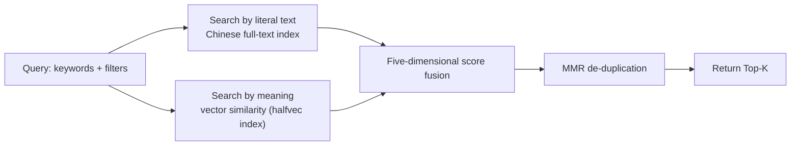

# Memory Hub · 记忆中枢

> **Language / 语言**: [English](README.en.md) · [简体中文](README.md)

**A long-term memory ledger shared by a whole team of AI assistants: it remembers, it retrieves, it keeps things apart, it never loses them.**

[](https://www.rust-lang.org)
[](https://doc.rust-lang.org/edition-guide/rust-2021/index.html)
[](https://github.com/orderye/memory-hub/actions/workflows/ci.yml)
[](https://github.com/orderye/memory-hub/actions/workflows/ci.yml)
[](https://modelcontextprotocol.io/)
[](https://www.postgresql.org/)
[](LICENSE-MIT)

[](https://www.kimi.com/code) [](https://github.com/deepseek-ai/deepseek-harness)

Put plainly: **AI assistants forget everything the moment you close the window. This service stores what is worth remembering so the next session can pick it up.**

On the outside it is a standard MCP server, so Claude Desktop, Cursor, Cline, LangChain and other agent frameworks can connect to it directly.
On the inside it takes care of four things — **storage, backup, consolidation, evolution**.

> **What it deliberately does not do (this matters)**: it does not stuff prompt conventions into your memories, and it does not make reasoning decisions for your agent.
> It only guarantees that "the memory it hands back is real, structured, and backed by evidence". How you use it is your agent's business.

---

## Table of contents

- [1. The problem it solves](#1-the-problem-it-solves)
- [2. The shape of it: three processes + one database](#2-the-shape-of-it-three-processes--one-database)
- [3. Quick start](#3-quick-start)
- [4. How memories are organized](#4-how-memories-are-organized)
- [5. How retrieval works](#5-how-retrieval-works)
- [6. Security and reliability](#6-security-and-reliability)
- [7. The MCP tool surface (38 tools)](#7-the-mcp-tool-surface-38-tools)
- [8. Project layout](#8-project-layout)
- [9. Development, testing and quality gates](#9-development-testing-and-quality-gates)
- [10. Known limitations and what's next](#10-known-limitations-and-whats-next)
- [11. Documentation map](#11-documentation-map)

---

## 1. The problem it solves

The pain of giving agents long-term memory is always in the same handful of places. Here is "the pain" next to "what this service does about it":

| Common pain | What Memory Hub does |
| :--- | :--- |
| **The assistant forgets as soon as the window closes** | Memories live on the server (PostgreSQL), so a new session or a different machine can pick them up |
| **Several assistants each keep their own copy, duplicating and contradicting each other** | The consolidation hub detects duplicates and conflicts on its own; it can merge high-confidence cases automatically and raise proposals for a human to adjudicate |
| **Stale information gets pulled back in as if it were new** | Memories carry a validity window (`valid_from` / `valid_until`). When a new fact supersedes an old one, the old entry is automatically sealed off and retrieval stops returning it |
| **The model invents facts and invents code changes** | Raw material is stored as **append-only evidence** (`memory_evidence`) before anything is distilled. Code changes are only accepted from real Git diffs, never from the model's own account |
| **A trick that works on this machine causes damage on another** | Experience entries carry applicable-environment tags (e.g. `linux`, `k8s`). When the environment does not match, retrieval **warns explicitly and down-weights** |
| **Multi-tenant / multi-user data sees each other** | Accounts are hard sandbox boundaries: even two accounts using the same namespace name see completely separate data (there are tests pinning cross-tenant access at exactly 0) |
| **The memory store gets slow and messy over time** | Keyword + semantic dual-path retrieval, MMR de-duplication of similar hits, and automatic degradation to keyword-only when the vector service is down — the retrieval endpoint never hangs |

### Positioning in one line

Not "yet another agent framework" — only **infrastructure**: a memory foundation that multiple agents can share, that is isolated per account, and that can be backed up and restored.

---

## 2. The shape of it: three processes + one database

| Process | External form | What it owns (by analogy) |
| :--- | :--- | :--- |
| **`mcp-server`** | HTTP `:3000` (`/mcp` Streamable HTTP, `/sse` legacy SSE), stdio also supported | The library front desk: takes memory read/write and retrieval requests, exposes 38 MCP tools |
| **`auth-server`** | HTTP `:8080`, with a web console | The gatekeeper and the licensing office: registers accounts and agents, issues tokens (OAuth 2.1) |
| **`backup-worker`** | Long-running background process with cron jobs | The night-shift admin: scheduled backup snapshots, expiry cleanup, offline duplicate and conflict scans |
| **PostgreSQL 15 + pgvector** | Data files | The warehouse itself (local development can swap in pure in-memory mode — it forgets on restart, debug use only) |

All three processes are **stateless**, so you can run several instances of each to absorb load.

> **Two-process shape (optional)**: set `HUB_EMBEDDED_WORKER=1` on `mcp-server` and the
> backup-worker's resident jobs (scheduled backups, expiry/evidence cleanup, integration
> scans) run inside the MCP process with the **same cron and cross-process lease**, shrinking
> the deployment to auth-server + mcp-server. Lite deployments enable it by default; the job
> logic lives in one place (`worker::embedded`), so the standalone process and the embedded
> mode behave identically.


---

## 3. Quick start

### Two deployment shapes: Personal Lite / Production Full

One codebase, one database schema, one backup format — a single setting picks the **default behavior**:

| | Personal Lite | Production Full (default) |
| :--- | :--- | :--- |
| Fits | single machine, one person, a few agents | teams / multi-account / public service |
| Processes | postgres + auth-server + mcp-server (three) | plus a **long-running** backup-worker (four) |
| Embedding | `HUB_EMBED_PROVIDER=off`: no vectors, no outbound calls | `mock` (dev) or `http` (real semantics) |
| Retrieval | keyword-only (FTS + five-signal scoring + `min_score` rejection) | keyword + pgvector semantic recall |
| Consolidation | local rules only (embedding calls stay 0) | same, may opt into `hybrid` |
| Background jobs | embedded in mcp-server (scheduled backups + daily scans; sweeps still manual `--once`) | resident process: cron backups + periodic sweeps + cross-replica lease |
| Security | OAuth 2.1 / ACL / account isolation / backup & restore **all kept** | same |

> **Upgrading changes nothing by default**: `HUB_DEPLOYMENT_PROFILE` defaults to `production`,
> so leaving it unset means today's behavior. Lite is just a different set of defaults
> for the same implementation, not a second codebase.

### Option A: one-command Docker Compose (recommended)

```bash
git clone https://github.com/orderye/memory-hub.git && cd memory-hub

# 1. Copy the configuration template
cp .env.example .env

# 2. Fill in at least these two required values:
#    - HUB_TOKEN_SECRET: token signing secret, a random string of at least 32 bytes
#      (both services must use the same value)
#    - POSTGRES_PASSWORD: database password (compose refuses to start without it)
#
# 3. Build and start all 4 containers (database + auth + MCP + background worker)
docker compose up -d --build

# 4. Check status and logs
docker compose ps
docker compose logs -f mcp-server
```

Once it is up, open <http://localhost:8080/account/register> to register an account, then <http://localhost:8080/console> to register an agent (you get a `client_id` / `client_secret` there).

### Option A2: personal lightweight deployment (Lite)

```bash
# 1. Same .env (at least HUB_TOKEN_SECRET and POSTGRES_PASSWORD)
cp .env.example .env

# 2. Start Lite: three-process shape (scheduled backups embedded in mcp-server), embedding off
docker compose -f docker-compose.lite.yml up -d --build

# 3. On demand, run one full job cycle (including the sweeps the embedded mode skips)
docker compose -f docker-compose.lite.yml run --rm backup-worker --once
```

Under Lite, `memory_search` is **keyword-only**: the response carries `capabilities.keyword_only=true`,
while `/capabilities` reports `retrieval.vector_path_enabled=false` and `semantic.ready=false`.
To enable real vectors, set `HUB_EMBED_PROVIDER=http` + `HUB_EMBED_ENDPOINT` + `HUB_EMBED_API_KEY`
in `.env` and restart — **only an explicit configuration sends memory content to an embedding endpoint**.

### Option B: run it locally (development)

No PostgreSQL on the machine? `memory://local` is pure in-memory mode:

```bash
# Terminal 1: authorization server
HUB_DB_URL=memory://local HUB_TOKEN_SECRET=dev-secret-at-least-32-chars-long \
  cargo run --bin auth-server

# Terminal 2: MCP server
HUB_DB_URL=memory://local HUB_TOKEN_SECRET=dev-secret-at-least-32-chars-long \
  cargo run --bin mcp-server

# Terminal 3 (optional): background jobs
HUB_DB_URL=memory://local HUB_TOKEN_SECRET=dev-secret-at-least-32-chars-long \
  cargo run --bin backup-worker
```

### First call: get a token → write a memory → find it again

**Step 1: a machine agent exchanges `client_credentials` for a token**

```bash
TOKEN=$(curl -s -X POST http://localhost:8080/oauth/token \
  -d "grant_type=client_credentials" \
  -d "client_id=agent-alpha" \
  -d "client_secret=your-agent-secret" \
  -d "scope=memory:write memory:read memory:admin" \
  | jq -r .access_token)

echo "got token: ${TOKEN:0:16}..."
```

**Step 2: write a memory**

The MCP endpoint is `http://localhost:3000/mcp`, plain JSON-RPC.

```bash
curl -s -X POST http://localhost:3000/mcp \
  -H "Authorization: Bearer $TOKEN" \
  -H "Content-Type: application/json" \
  -d '{
    "jsonrpc": "2.0",
    "id": 1,
    "method": "tools/call",
    "params": {
      "name": "memory_put",
      "arguments": {
        "namespace": "infra-team",
        "key": "db-cluster-spec",
        "kind": "fact",
        "content": "The production database has been upgraded to PostgreSQL 16, with the pgvector vector index enabled",
        "tags": ["database", "infra", "pgvector"],
        "confidence": 0.98
      }
    }
  }' | jq .
```

**Step 3: retrieve it**

```bash
curl -s -X POST http://localhost:3000/mcp \
  -H "Authorization: Bearer $TOKEN" \
  -H "Content-Type: application/json" \
  -d '{
    "jsonrpc": "2.0",
    "id": 2,
    "method": "tools/call",
    "params": {
      "name": "memory_search",
      "arguments": {
        "namespace": "infra-team",
        "query_text": "Which version does the production database run?",
        "scene": "working",
        "top_k": 3
      }
    }
  }' | jq .
```

**Step 4: tidy up and back up**

```bash
# Scan for duplicates and conflicts; high-confidence ones merge directly, the rest become proposals
curl -s -X POST http://localhost:3000/mcp -H "Authorization: Bearer $TOKEN" \
  -H "Content-Type: application/json" \
  -d '{"jsonrpc":"2.0","id":3,"method":"tools/call","params":{"name":"memory_consolidate",
       "arguments":{"namespace":"infra-team","dry_run":false,"auto_merge":true}}}' | jq .

# Take an immutable snapshot
curl -s -X POST http://localhost:3000/mcp -H "Authorization: Bearer $TOKEN" \
  -H "Content-Type: application/json" \
  -d '{"jsonrpc":"2.0","id":4,"method":"tools/call","params":{"name":"memory_backup_create",
       "arguments":{"namespace":"infra-team"}}}' | jq .
```

### Connecting MCP clients: three transports (Stdio / Streamable HTTP / SSE)

MCP clients (Cherry Studio, Claude Desktop, Cursor, Cline, ZCode, ...) all ask you to pick a transport when adding a server. All three are supported here, running the same 38 tools — only the way JSON-RPC frames travel differs:

| Client option | Address / how it starts | When to use it |
| :--- | :--- | :--- |
| **Stdio** | spawn `mcp-server` as a child process (`HUB_SERVE_MODE=stdio`) | single-user local use, no open port |
| **Streamable HTTP** | `http://localhost:3000/mcp` | **recommended**: the default protocol of modern MCP clients |
| **SSE** | `http://localhost:3000/sse` | compatibility: clients that only speak the legacy (2024-11-05) HTTP + SSE transport |

#### 1. Stdio

The server lives as a child process inside the client, exchanging newline-delimited JSON-RPC frames over stdin/stdout:

```json
{
  "mcpServers": {
    "memory-hub": {
      "type": "stdio",
      "command": "cargo",
      "args": ["run", "--bin", "mcp-server"],
      "env": {
        "HUB_SERVE_MODE": "stdio",
        "HUB_DB_URL": "memory://local",
        "HUB_TOKEN_SECRET": "dev-secret-at-least-32-chars-long",
        "HUB_STDIO_LOCAL_AGENT": "local-agent"
      }
    }
  }
}
```

- Point `HUB_DB_URL` at PostgreSQL to share the same memory store as other deployments;
- `HUB_STDIO_LOCAL_AGENT` only takes effect with `HUB_DEPLOYMENT_PROFILE=lite`: the stdio session is treated as "the process owner's local bridge" and runs with full bootstrap privileges; unset, stdio requires a Bearer token just like HTTP;
- Docker deployments can bridge over stdio too: `"command": "docker", "args": ["exec", "-i", "<mcp container>", "mcp-server"]` with `HUB_SERVE_MODE=stdio` set in the container.

> Claude Desktop natively supports only Stdio; Cursor / Cherry Studio and similar support all three — spell `type` the way your client expects (e.g. `streamableHttp` / `http`).

#### 2. Streamable HTTP (recommended)

Every JSON-RPC frame is POSTed to a single endpoint, no handshake:

```json
{
  "mcpServers": {
    "memory-hub": {
      "type": "streamableHttp",
      "url": "http://localhost:3000/mcp",
      "headers": { "Authorization": "Bearer <token from the steps above>" }
    }
  }
}
```

Tokens come from the auth server: `POST http://localhost:8080/oauth/token` (`client_credentials`), see "First call" above. In local dev (in-memory mode) you may call `initialize` / `tools/list` without a token, but `tools/call` always requires one.

#### 3. SSE (legacy compatibility)

The client opens a downstream event stream with `GET /sse`; the server pushes an `endpoint` event naming the upstream address (`/messages?sessionId=...`); JSON-RPC frames are then POSTed there and responses come back over the same stream. Clients only need the `/sse` URL:

```json
{
  "mcpServers": {
    "memory-hub": {
      "type": "sse",
      "url": "http://localhost:3000/sse",
      "headers": { "Authorization": "Bearer <token from the steps above>" }
    }
  }
}
```

Two caveats:

- **Disable proxy buffering**: SSE is a long-lived event stream; nginx-style buffering stalls it. The server already sends `X-Accel-Buffering: no` and excludes `/sse` from the 30s request timeout — when adding your own reverse proxy, set `proxy_buffering off` as well;
- **Sessions are bound to the connection**: when the SSE stream drops, the session dies; reconnecting yields a new `sessionId`.

> When to pick SSE: only when the client implements just the 2024-11-05 "HTTP with SSE" transport. Otherwise prefer Streamable HTTP.

---

## 4. How memories are organized

### 1. Evidence first, conclusions second

Before anything is distilled out of raw material, the raw material itself is stored verbatim in `memory_evidence` (append-only).
The distilled fact then points at the evidence ID, so any memory can answer "what makes you say that?".

### 2. Every memory has a notion of time

- `occurred_at`: when the thing **actually happened** (not "when it was written down");
- `valid_from` / `valid_until`: **when this information was true**.

For example: after a primary node is switched from v1 to v2, the system automatically seals the `valid_until` of the v1 entry, and retrieval returns only v2 by default.
When you need the older story, pass `include_superseded` and the historical entries come back with a down-weighting factor — the history is preserved, but it does not interfere with the current answer.

### 3. Three cognitive memory layers, each with its own job

| Scene | What it holds | Key points |
| :--- | :--- | :--- |
| **Chat** (conversation) | Facts `Fact`, summaries `Summary`, long-term preferences `Pattern`, pending intentions `Intention` | Intentions carry a validity window and expire automatically; hedged wording such as "maybe / TBD" is rejected before it is stored, so you never accumulate hallucinated to-dos; ingestion can be fully automatic, semi-automatic, or human-adjudicated |
| **Working** (getting things done) | Per-task `WorkingFact` and reusable `Experience` are stored separately | Distillation only produces a **candidate**; it becomes verified only through an explicit `verify` that requires at least two distinct completed sources, no failed sources, and a declared validation method; it carries applicable-environment tags and warns plus down-weights on mismatch; every state transition writes a version snapshot |
| **Coding** (changing code) | Logical thread `CodingThread` + version slice `CodingRevision` | Only **real Git diffs** are recorded; writing the same patch twice is idempotent; private keys, tokens and other sensitive strings are scanned for and truncated; read-only queries by thread / file / revision rebuild the evolution and rollback chain |

### 4. Experience assets: distillation is only a candidate, verification is what promotes it

An "experience" in the Working scene is not reusable the moment it is written. It follows an explicit asset lifecycle:

```
work fact ──distill──▶ candidate
                          │
                          │ verify (≥2 distinct completed sources + no failures + validation)
                          ▼
                        active (verified, reusable)
                          │
        reject (reason) ──┼── deprecate (reason)
                          ▼
                    rejected / deprecated (sources and versions retained, never hard-deleted)
```

- **One success does not verify anything**: positive feedback only raises the feedback score, never the state; neither distillation nor background jobs can promote a candidate;
- **Recommendations stay inside the declared scope**: a `boundary_envs` mismatch down-weights the hit, or is rejected outright under `strict_env`;
- **Versions are never lost**: every transition appends to `memory_experience_versions` (one row per version), so you can see who changed what, when, and why;
- **Retrieval has a priority ladder**: `active` 1.0, `candidate` 0.6, `deprecated` 0.3; `rejected` / `archived` are not returned by default.

Tools: `working_experience_distill`, `working_experience_transition`, `working_experience_history`, `working_experience_feedback`. Details: [`docs/upgrade/ASSET_GOVERNANCE.md`](docs/upgrade/ASSET_GOVERNANCE.md).

### 5. Agent memory collections: narrow the scope, never grant access

Different agents can use different "memory collections" (for example a Coding agent that only sees project conventions, past incidents and verified fixes). A collection is account-level configuration:

- it only declares **candidate scope** (namespaces, scene, kinds, tags, statuses, whether experiences are included);
- the calling agent **must be explicitly bound**, otherwise the request is rejected (fail closed);
- binding never bypasses ACL: retrieval still authorizes each namespace in real time, and unauthorized namespaces appear in `skipped_namespaces` instead of silently becoming an empty result;
- unbinding takes effect immediately; deleting a collection removes bindings only and **never deletes memories**.

Tools: `memory_collection_upsert/list/delete/bind/unbind`; `memory_search` and `working_experience_search` accept `collection` instead of `namespace`. Details: [`docs/upgrade/ASSET_GOVERNANCE.md`](docs/upgrade/ASSET_GOVERNANCE.md).

### 6. Words you will keep seeing

| Term | Plain meaning |
| :--- | :--- |
| `namespace` | A "filing room", e.g. `infra-team`. The first agent to write into it automatically becomes its owner |
| `key` | A label on a file folder in that room. Writing the same `namespace` + `key` again is a **revision**, and the version number goes up by one |
| `kind` | What kind of memory this is: fact / preference / episode / skill… |
| `scene` | Which situation it applies to: `chat` / `working` / `coding`; retrieval narrows by scene |
| `layer` | Cognitive layer — structured knowledge ranks above raw observation, so scoring gives structured knowledge a higher prior |
| `confidence` | A 0–1 score for how much to trust it |
| `ttl_seconds` | Time to live; it is archived automatically when it runs out (archived, not deleted) |

---

## 5. How retrieval works

Picture a librarian:

1. **Two paths at once**: one searches by **literal text** (Chinese full-text index with built-in tokenization, no external segmenter needed), the other searches by **meaning** (vector similarity over a pgvector HNSW **halfvec partial index** — only `active` / `archived` rows are indexed, at roughly half the fp32 size);
2. **Filters are pushed down to the storage layer**: scene, layer, validity window, status and tags are applied while candidates are being fetched, so no scoring effort is wasted;
3. **Five-dimensional scoring**: a weighted sum of five signals, formula below;
4. **Result de-duplication (MMR)**: near-identical hits do not crowd out the top slots, leaving room for genuinely different information. The ANN path follows a "thin-column contract" and never ships vector text back; the similarities MMR needs are fetched in a second pass over a `top_k × 4` candidate pool, avoiding large-field traffic;
5. **It does not fall over**: vector service failure → automatically degrades to pure keyword retrieval; query timeout → keeps the results the other path already returned; only when both paths come up empty does it fall back to a cursor listing.

> Since 2026-10-27 (migration 015) the vector index is a **halfvec partial index**: the query side
> `embedding::halfvec(1024) <=>` must match the index expression verbatim, and filtered ANN
> relies on `hnsw.iterative_scan` plus `hnsw.ef_search=100` to fill the result set; rebuilding
> and observability are covered in [`docs/pg-maintenance-runbook.md`](docs/pg-maintenance-runbook.md).

The scoring formula (a weighted sum of semantic similarity, keyword hit, confidence, freshness and layer prior):

$$\text{Score} = w_{sim}\cdot\text{semantic similarity} + w_{kw}\cdot\text{keyword hit} + w_{conf}\cdot\text{confidence} + w_{rec}\cdot\text{freshness} + w_{prior}\cdot\text{layer prior}$$

Two things that are easy to get wrong:

- **Keyword hits are weighted by in-pool IDF**: rarer words count for more, so `api` does not randomly match `rapid`;
- **Freshness is based on event time** (not update time), and decays at a different rate per memory type: preferences 180 days / skills 90 days / facts 60 days / episodes 14 days / notes 7 days. Both the weights and the time constant can be overridden by environment variables (`HUB_SCORE_WEIGHTS`, `HUB_RETRIEVAL_RECENCY_TAU_DAYS`), and a separate weight set can be configured per scene.

### If there is no reliable match, it says so

Retrieval has a **default rejection threshold**, `HUB_RETRIEVAL_MIN_SCORE` (0.65 by default): anything below it is discarded.
If nothing survives, the tool returns `{"results": [], "no_reliable_match": true}` —
**telling the caller plainly that it found nothing reliable**, instead of padding the answer with a low-scoring hit.

For long-term memory the difference matters a lot: force a low-scoring answer onto an out-of-domain question and the agent will treat it as factual, answering the wrong thing at best and writing a wrong fact into memory at worst. The threshold can also be set per scene
(`HUB_SCENE_MIN_SCORE_PROFILES="chat=0.70;working=0.60"`), or overridden per call with `min_score`.

> The threshold is calibrated in **pseudo-vector** (purely lexical) mode and **must be recalibrated** once you switch to a real embedding model.
> See [`docs/upgrade/EVALUATION.md`](docs/upgrade/EVALUATION.md) for how to run the calibration curve.

### Whether semantic capability is ready is decided by the health check

The cosine similarity of a pseudo-vector embedder (`HUB_EMBED_PROVIDER=mock`) is **noise**, not semantics.
The system recognizes this at startup and:

- **keeps the vector dimension out of scoring**: that dimension is treated as "unavailable" and the remaining dimensions are re-normalized
  (the configured weights **do not change**; with a real model the dimension rejoins scoring with the same weight);
- **declares it honestly in the health check**: `GET /readyz` and `GET /capabilities` return
  `semantic.ready` plus the reason, so "lexical retrieval" is never passed off as "semantic retrieval";
- **logs a loud warning at startup**, so nobody mistakes "the endpoint returns results" for "semantic retrieval works".



### Measured numbers (evaluation baseline, Bench v2)

The evaluation set is **programmatically generated, fixed-clock and reproducible**: 60 topics, **480 documents / 600 queries**,
covering exact hits, semantic paraphrase, temporal evolution, scene separation, environment boundaries and noise negatives, dataset fingerprint `9f5b3b075a558371`.

```bash
# Run the retrieval evaluation (defaults to deterministic pseudo-vectors; detects pipeline and ranking regressions)
cargo test --test eval_bench -- --nocapture
# Freeze / refresh the baseline
HUB_EVAL_WRITE_BASELINE=1 cargo test --test eval_bench
# Ablations (per-signal weights / MMR λ / freshness τ / scene preference)
HUB_EVAL_ABLATIONS=1 cargo test --test eval_bench -- --ignored --nocapture
# Threshold calibration: sweep min_score and print the out-of-domain rejection vs. in-domain recall trade-off curve
HUB_EVAL_CALIBRATE=1 cargo test --test eval_bench -- --ignored --nocapture
# Evaluate against a real embedding service (mandatory for semantic acceptance)
HUB_EVAL_EMBED_ENDPOINT=https://…/v1/embeddings HUB_EVAL_EMBED_MODEL=bge-m3 \
  HUB_EVAL_REQUIRE_SEMANTIC=1 cargo test --test eval_bench -- --nocapture
```

Current frozen baseline (**pseudo-vector mode**, including the default rejection threshold `min_score=0.65`):
Recall@1 68.15% / Recall@5 95.37% / Recall@10 97.22% / MRR@10 0.7989 / nDCG@10 0.6649,
hard-negative violation rate (Top-3) 19.63%, **first-position mis-hit rate 0.56%**, **out-of-domain false-recall rate 0.00%**,
in-process p50 ≈ 10.1 ms, p95 ≈ 28.4 ms.

> **Do not be fooled by the baseline numbers**: this round used mock pseudo-vectors, and under pseudo-vectors the **semantic dimension is noise** —
> the system now **automatically recognizes** a pseudo-vector embedder and excludes the vector dimension from scoring (the configured weights are unchanged,
> and with a real model the dimension rejoins), so these numbers only prove that "the pipeline and lexical ranking have not regressed".
> They are **not** a semantic-capability conclusion. The `semantic_ready: false` marker in the baseline file says exactly that.
> Once you plug in a real embedding model you must re-run with `HUB_EVAL_EMBED_*` and re-freeze the baseline.
> For the full methodology, per-stratum metrics and ablation results see [`docs/upgrade/EVALUATION.md`](docs/upgrade/EVALUATION.md).

### Three layers of gates: a relative gate is not enough

| Layer | Basis of judgement | What it catches |
| :--- | :--- | :--- |
| **Relative gate** | Per-query paired comparison against the frozen baseline (Δ > 1pt and \|z\| ≥ 2) | Metric **regressions** |
| **Absolute gate** | Out-of-domain false-recall rate ≤ 10%; first-position mis-hit rate ≤ 2% | Long-standing defects (they do not change between versions, so a relative gate can never catch them) |
| **Business-correctness gate** | **Zero** violations of time validity / scene / tag / layer / environment boundaries | Hard errors, unrelated to ranking quality |

"no worse than last time" is not the same as "good enough": a weak baseline that does not degrade still passes the test.
So the out-of-domain false-recall rate, the first-position mis-hit rate and the business constraints are all judged **absolutely**, without reference to the baseline.

The gate itself is designed to avoid false alarms: the baseline stores **the per-query result of every query**, and regression is judged by pairing on query ID to compute the delta Δ and the significance z, requiring "Δ greater than 1 percentage point **and** |z| ≥ 2" to count as a regression; when sample coverage is insufficient, or the dataset fingerprint, the embedder, or the **evaluation configuration** differ, it declares the runs "not comparable" instead of comparing apples to oranges.

---

## 6. Security and reliability

### Account isolation and authorization

- **The account is the sandbox**: account A and account B are fully isolated in data, authorization and backups even when they use the same namespace name, and tests pin cross-tenant retrieval at exactly 0;
- **Standard OAuth 2.1**: dynamic client registration (RFC 7591), mandatory PKCE S256, refresh-token rotation with replay detection, audience binding (RFC 8707);
- **Namespace-level authorization**: whoever owns a space can read and write it, a space can be granted to another agent, and the grant can be revoked at any time (effective immediately);
- **Three permission scopes**: `memory:read` / `memory:write` / `memory:admin`, and every tool declares which one it needs.

### Permission boundaries for cognitive memory

- **Every cognitive tool checks the namespace ACL**: Working tasks and experiences, Coding threads and revisions, Chat proposals and intentions no longer check only the token scope; unauthorized namespaces inside the same account are rejected;
- **A collection is not a permission**: `memory_collection_*` only narrows the candidate scope, reads still go through real-time authorization; unbound or unbound-after-revoke agents are rejected;
- **Explicit single-namespace requests fail closed**: when `namespace` is given, missing permission returns an error; only `collection` fan-out demotes unauthorized namespaces into `skipped_namespaces` and explains it in the response.

### Two candidate-discovery modes for consolidation (A / B)

The consolidation hub tidies up memories that several agents wrote redundantly. It has two **candidate-discovery** modes,
but they **share one decision and merge pipeline** — the mode only changes "where candidates come from", never "whether they may be merged".

| Mode | Configuration | Where candidates come from | Embedding calls | Memory content leaves the host |
| :--- | :--- | :--- | :--- | :--- |
| **B — pure local rules** (default) | `HUB_CONSOLIDATION_MODE=rules` | Normalized fingerprints, structured fields (business key / scene / tags / environment), local lexical index | **always 0** | **no** |
| **A — vector-assisted** | `HUB_CONSOLIDATION_MODE=hybrid` | B's candidates **∪** semantic candidates recalled by embedding vectors | On demand, bounded, countable | Depends on the embedding endpoint |

- **B is the default**: even with `HUB_EMBED_PROVIDER=http` configured, consolidation will not call a vector service on its own —
  whether memory content may be sent out has to be an explicit administrator decision;
- **A is only "vectors help you find candidates"**: a high cosine similarity only means "these two are worth looking at together",
  never "these two are the same". `PostgreSQL 15` and `PostgreSQL 16` are semantically very close but are different facts,
  and must never be merged. **Only memories that are byte-identical, or identical after conservative normalization, may be auto-merged**;
  semantic near-duplicates always produce a proposal for review;
- **Normalization is conservative**: it folds only whitespace, line breaks and Unicode compatibility forms.
  Case, negations, numbers, units, dates, version numbers, paths and URLs are all preserved
  ("not X" and "X", "v1" and "v2" never land on the same fingerprint);
- **Degradation is explicitly visible**: with `HUB_CONSOLIDATION_FALLBACK=rules`, if the vector service is unavailable the run degrades to rules mode
  and the response states `requested_mode=hybrid` / `effective_mode=rules` / `fallback_applied=true`,
  so a degraded run is never passed off as a successful vector consolidation; `=error` fails outright and performs no consolidation;
- **Consolidation and retrieval do not interfere**: the consolidation mode does not change the retrieval mode, the scores or MMR of `memory_search`;
  consolidation mode B is also **not** the same as "the whole system is offline" (whether retrieval and cognitive distillation call models is a separate question);
- The health check reports `semantic` (retrieval semantic capability) and `consolidation` (consolidation mode) **separately**.

```bash
# B is the default: not a single embedding request is sent
HUB_CONSOLIDATION_MODE=rules

# To use A: start with dry runs and watch the candidate quality
HUB_CONSOLIDATION_MODE=hybrid
HUB_EMBED_PROVIDER=http
HUB_EMBED_ENDPOINT=https://embed.example.com/v1/embeddings
HUB_EMBED_MODEL=bge-m3
```

Details in [`docs/upgrade/CONSOLIDATION_AB.md`](docs/upgrade/CONSOLIDATION_AB.md).

### Backup and restore

- **Read-only snapshots**: a single namespace or an entire account (`*`) can be snapshotted, with a SHA-256 checksum; once written, a snapshot is immutable;
- **Three restore postures**: `dry_run` previews the result (it also validates the target scope and write permissions, with zero writes); `merge` merges incrementally (recommended); `replace` replaces wholesale;
- **`replace` is atomic**: a safety backup is forced for every affected namespace first (any failure aborts before a single row is deleted), and clearing plus rebuilding happens inside **one store transaction** — a mid-way failure rolls back;
- **A fatal `merge` failure rolls back automatically**: the compensation ledger deletes what this run created and revises updated entries back to their pre-image; individual secondary-entity failures are only counted (`partial=true`) — use `replace` when you need strict consistency;
- **Checksum and payload version are verified before restoring** (v1–v6 supported); a mismatch refuses the restore outright.

See [`docs/backup-restore.md`](docs/backup-restore.md) for the real boundaries of automatic rollback and the remaining risks.

---

## 7. The MCP tool surface (38 tools)

18 `memory_*` tools are the base; 15 `cognitive_*` / `working_*` / `coding_*` tools are the cognitive layer; 5 `memory_collection_*` tools cover collection governance.

### 1. Basic storage (4)

| Tool | Scope | What it does |
| :--- | :--- | :--- |
| `memory_put` | `memory:write` | Write or revise (the same `namespace` + `key` bumps the version automatically) |
| `memory_get` | `memory:read` | Fetch one entry by ID or business key |
| `memory_update` | `memory:write` | Change part of an entry (content / tags / metadata / confidence / TTL) |
| `memory_delete` | `memory:write` | Soft delete: archive while keeping the full history |

### 2. Retrieval and statistics (4)

| Tool | Scope | What it does |
| :--- | :--- | :--- |
| `memory_search` | `memory:read` | Hybrid retrieval. Accepts `scene`, `layer`, `valid_at`, `include_superseded`, `min_score` |
| `memory_list` | `memory:read` | List by criteria, with cursor pagination |
| `memory_stats` | `memory:read` | Namespace statistics (totals, status, type distribution, expiring within 24h) |
| `memory_history` | `memory:read` | The complete version history of one entry |

### 3. Consolidation and proposal governance (5)

| Tool | Scope | What it does |
| :--- | :--- | :--- |
| `memory_consolidate` | `memory:write` | One-shot tidy-up: dedupe, detect conflicts, score staleness, merge per policy. Optional `mode` argument selects the candidate-discovery mode (per-request override is denied by default) |
| `memory_consolidation_stats` | `memory:read` | Consolidation health (duplicate groups, conflict groups, stale entries, redundancy ratio, health score) |
| `memory_integrate_scan` | `memory:write` | Scan and raise proposals for review (groups that already have an open proposal are skipped). Optional `mode` argument, same semantics |
| `memory_integration_list` | `memory:read` | List open proposals |
| `memory_integration_resolve` | `memory:write` | Adjudicate a proposal: `merge` merges while preserving lineage / `dismiss` keeps them separate |

### 4. Backup and restore (3)

| Tool | Scope | What it does |
| :--- | :--- | :--- |
| `memory_backup_create` | `memory:admin` | Take an immutable snapshot (a namespace or `*` for everything), with a SHA-256 checksum |
| `memory_backup_list` | `memory:admin` | List snapshots and their sizes |
| `memory_restore` | `memory:admin` | Restore: `dry_run` / `merge` / `replace` (a safety backup is taken before replace) |

### 5. Permission management (2)

| Tool | Scope | What it does |
| :--- | :--- | :--- |
| `memory_grant` | `memory:admin` | Grant one of your namespaces to another agent |
| `memory_revoke` | `memory:admin` | Revoke a grant, effective immediately |

### 6. Cognitive layer and governance (20)

| Tool | Scope | What it does |
| :--- | :--- | :--- |
| `cognitive_chat_propose` | `memory:write` | Feed a multi-turn conversation in for cognitive distillation (candidate facts, entity relations, consolidation proposals) |
| `cognitive_proposal_resolve` | `memory:write` | Review cognitive proposals: accept / reject / edit and merge |
| `cognitive_intentions_list` | `memory:read` | List current intentions and candidate proposals (see whether any intention has expired) |
| `working_task_start` | `memory:write` | Open a work task, optionally linked to evidence |
| `working_task_finish` | `memory:write` | Close a task, recording a result summary or a failure reason |
| `working_experience_distill` | `memory:write` | Distil a task into a **candidate** experience (preconditions, boundary environments, known failure modes, validation method) |
| `working_experience_feedback` | `memory:write` | Give an experience a feedback score (+1 useful / -1 a trap); adjusts the score only, never the lifecycle state |
| `working_experience_search` | `memory:read` | Search reusable experiences with environment boundary matching; filter by status or a memory collection |
| `working_experience_transition` | `memory:write` | Lifecycle transition: `verify` (source + validation gates) / `reject` / `deprecate` / `restore` |
| `working_experience_history` | `memory:read` | Read the append-only version history of an experience |
| `coding_thread_create` | `memory:write` | Open a code-evolution / refactoring logical thread |
| `coding_thread_list` | `memory:read` | List code-evolution threads |
| `coding_revision_record` | `memory:write` | Record a code revision (real diff, change kind, safe relative path, symbol fingerprint) |
| `coding_revision_list` | `memory:read` | List revisions by thread or file to rebuild the evolution/rollback chain |
| `coding_revision_get` | `memory:read` | Read a single revision snapshot |
| `memory_collection_upsert` | `memory:admin` | Create/update an agent memory collection (narrows candidates only; grants nothing) |
| `memory_collection_list` | `memory:admin` | List the account's memory collections |
| `memory_collection_delete` | `memory:admin` | Delete a collection (bindings cascade; memories are untouched) |
| `memory_collection_bind` | `memory:admin` | Bind a collection to an agent in the same account |
| `memory_collection_unbind` | `memory:admin` | Unbind (effective immediately; memories are untouched) |

---

## 8. Project layout

A standard Rust workspace, layered by responsibility:

```text
.
├── Cargo.toml                  # Workspace and shared dependencies
├── Dockerfile                  # Multi-stage production image
├── docker-compose.yml          # One-command orchestration (DB + three services)
├── docker-compose.lite.yml     # Lite orchestration (three processes, scheduled jobs embedded in mcp-server)
├── .cnb.yml                    # CNB cloud build: PR / branch push runs the quality gate; main push ships and deploys; tag push ships a versioned image; tag deploy trigger; branch-page button events
├── .cnb/tag_deploy.yml         # CNB custom deploy environment: Tag page → Deploy → production
├── .cnb/settings.yml           # CNB page UI customisation: NPC roles (memory steward / reviewer), button copy and hover images
├── .cnb/web_trigger.yml        # CNB branch-page custom buttons: deploy production / roll back one version / build image only / ask the memory steward
├── .github/workflows/ci.yml    # GitHub Actions: quality gate / PG integration / dependency audit / release build
├── scripts/push-cnb.sh         # Dual-platform push: replay and push the mirror under the CNB identity (patch-id based)
├── scripts/ci/deploy-production.sh  # Production deploy stage (switch image / probe / rollback), shared by all CNB pipelines
├── scripts/ci/rollback-production.sh  # Production rollback stage: switch back to the image in the server's previous_release.env, then probe
├── docs/                       # Design and specification documents (see section 11)
└── crates/
    ├── common/                 # Shared parts: strict config validation, redacted logging, rate limiting, cron, consolidation mode enums
    ├── mem-core/               # Domain core: memory and backup models, permissions, cognitive domain services, content fingerprints
    ├── consolidation/          # Consolidation hub: candidate discovery (rules / vectors), relation classification, tiered merging, automation policy
    ├── store/                  # Storage: PostgreSQL migrations plus a pure in-memory backend
    ├── embed/                  # Embedding: OpenAI-compatible HTTP client plus a deterministic mock
    ├── retrieval/              # Retrieval: Chinese tokenization, dual-path recall, five-dimensional scoring, MMR
    ├── authz/                  # Authorization: HS256 verification, audience checks, protected-resource metadata
    ├── auth-core/              # OAuth primitives: PKCE S256, token-family rotation, Argon2
    ├── auth-web/               # Authorization server: DCR, OAuth endpoints, account console
    ├── mcp/                    # MCP protocol layer: schemas for 38 tools (tools/, split by domain), HTTP / SSE / stdio transport (transport/), ecosystem adapter interceptor layer (adapter/)
    ├── worker/                 # Background jobs: scheduled snapshots, expiry cleanup, offline scans; embedded scheduling (embedded, shared with the two-process shape)
    └── bins/                   # Three independently deployable binaries
        ├── mcp-server/
        ├── auth-server/
        └── backup-worker/
```

---

## 9. Development, testing and quality gates

```bash
# Full test suite (default feature set; includes the contract snapshot, governance regression and lightweight cases)
cargo test --workspace

# Governance regression only (lifecycle / ACL / collections / Coding evolution chain)
cargo test -p mem-core --test asset_governance

# Static checks (zero-warning gate)
cargo clippy --workspace --all-targets -- -D warnings

# Format check
cargo fmt --all -- --check

# Retrieval evaluation baseline (ranking quality; must not regress)
cargo test --test eval_bench -- --nocapture

# Consolidation evaluation (consolidation quality: wrong-merge count, hard-constraint violations and
# the B-mode embedding call count must all be 0)
cargo test --test consolidation_eval -- --nocapture

# Real PostgreSQL integration tests (needs DATABASE_URL pointing at a test database)
cargo test -p store --features pg-integration -- --ignored
```

CI runs on two platforms; platform-specific pipeline detail lives in the configs, so this is only the summary:

- **GitHub Actions** (`.github/workflows/ci.yml`): quality gate (fmt / clippy / test / doc build, the same script as local),
  integration tests against a real PostgreSQL + pgvector database (serialized), dependency admission and security audit (cargo-deny + cargo-audit), release build of the three binaries.
- **CNB cloud build** (`.cnb.yml`): PRs and branch pushes run the same quality gate; a `main` push builds the image and deploys
  (probes `/readyz`, auto-rolls back on failure); a tag push produces a versioned image that can be deployed by hand from the Tag page.
  Branch-page one-click buttons, the NPC assistants and the cloud-native preview environment are CNB-exclusive capabilities;
  their detail lives in `.cnb/` (`web_trigger.yml` / `settings.yml` / `tag_deploy.yml`) and is not spelled out here.

### Rollback (application version / deployment shape)

Lite and Production share the same schema and backup format, so rolling back only involves binaries/images — no database rollback is needed.
Migration 015 only rebuilds the vector index and tightens table-level autovacuum without changing the table shape,
so a binary older than it keeps working after a rollback; the only difference is that its fp32 vector queries
no longer hit an index (015 drops the full fp32 index) and fall back to sequential scans — see
[`docs/pg-maintenance-runbook.md`](docs/pg-maintenance-runbook.md) to restore.

```bash
# 1. Roll back the application: check out the previous stable tag/commit and rebuild
git checkout <previous stable tag or commit>
docker compose up -d --build                              # Production
docker compose -f docker-compose.lite.yml up -d --build    # Lite

# 2. Roll back only the deployment shape: set HUB_DEPLOYMENT_PROFILE back to production
#    and restart. Data, accounts, ACLs and backups stay untouched (profile only changes defaults).
```

How to verify backup/restore (`dry_run` writes nothing, a checksum mismatch must refuse to restore,
`replace` must create a safety backup first) is documented in
[`docs/upgrade/LIGHTWEIGHT_EXECUTION_REPORT.md`](docs/upgrade/LIGHTWEIGHT_EXECUTION_REPORT.md).

> [!NOTE]
> **The spaces-in-path trap**: if the checkout lives in a directory containing spaces (some external drives, for example), use `cargo test --workspace` and
> **do not** add `--all-features` — the build script of the optional `tikv-jemallocator` feature does not support a path prefix containing spaces;
> the default allocator is more than good enough on every platform. See [`docs/upgrade/REPOSITORY_AUDIT.md`](docs/upgrade/REPOSITORY_AUDIT.md).

---

## 10. Known limitations and what's next

This section exists so nobody steps on a landmine, not to brag:

1. **Production must use a real embedding model**. The pseudo-vectors of `HUB_EMBED_PROVIDER=mock` only make development and testing reproducible; they carry zero semantic capability.
   Once you switch to the `http` provider, re-freeze the baseline following the evaluation procedure.
   Whether semantic capability is ready is **exposed honestly in the health check**: `GET /readyz` and `GET /capabilities`
   return `semantic.ready` and the reason, so "lexical retrieval" is never passed off as "semantic retrieval".
2. **The default rejection threshold is calibrated under pseudo-vectors**. `HUB_RETRIEVAL_MIN_SCORE` defaults to 0.65,
   which pushes the out-of-domain false-recall rate down to 0% (it used to be 100%), at the cost of a higher Top-3 hard-negative share
   (19.63%, but the **first-position** mis-hit rate is only 0.56%). Once you switch to a real embedding model you **must recalibrate**:
   run `HUB_EVAL_CALIBRATE=1` to get a new curve before setting the value.
3. **Some thresholds still need external annotation**: the thresholds for conflict and duplicate detection, and the real LLM extractor for Chat cognitive distillation, all still lack the resources to calibrate them.
4. **The `temporal` / `paraphrase` / `env` query categories are the current weak spot** and need a real embedding model before ranking quality can be re-measured.
5. **Immutable evidence does not mean "no redaction before writing"**: credential scanning, sensitive-fragment masking, minimal summarization and the retention window all happen at the
   **before-write / expiry-cleanup** gates, see [`docs/upgrade/CHAT_MEMORY.md`](docs/upgrade/CHAT_MEMORY.md).
6. **Consolidation no longer uses vectors by default**: `HUB_CONSOLIDATION_MODE` defaults to `rules` (pure local rule consolidation),
   so configuring a real embedding service does not automatically turn on vector consolidation; the semantic gain of mode A has to be
   validated with a real model and `cargo test --test consolidation_eval`, see
   [`docs/upgrade/CONSOLIDATION_AB.md`](docs/upgrade/CONSOLIDATION_AB.md).
7. **Cognitive async jobs are not wired yet, and the extractor is off by default**: `ChatCognitiveJob` (session distillation retries) and `ExperienceDistillJob` (experience distillation)
   exist and are tested, but **no binary schedules them** — a real LLM extractor is not integrated yet. Production defaults to
   `HUB_COGNITIVE_EXTRACTOR=disabled`: `cognitive_chat_propose` returns `E_METHOD_NOT_FOUND` and writes no evidence or proposals.
   Setting `mock` (development only) is the sole way to mount the placeholder extractor.
   See [`docs/upgrade/COGNITIVE_SCHEDULING_AUDIT.md`](docs/upgrade/COGNITIVE_SCHEDULING_AUDIT.md).
8. **Scheduled and manual backups share the v6 payload**: the periodic `backup-worker` snapshot and `memory_backup_create`
   use the same format (entries, **memory version history**, evidence, relations, tasks, experiences, experience version history,
   coding threads, coding revisions). Restore accepts v1–v6, but **an older binary cannot restore a v6 backup** — keep the new
   binary around before downgrading, or finish the restore first.
9. **Multiple replicas only get "no duplicate execution"** (via `HUB_JOB_LEASE_H`); resumable progress inside a single
   replica is not provided — bound big namespaces with `HUB_INTEGRATION_SCAN_MAX_ENTRIES`.
10. **Migration 015's index rebuild suits empty / small tables**: the `create index` (non-`CONCURRENTLY`) runs inside the
    startup migration transaction; for large tables, rebuild manually in a maintenance window per
    [`docs/pg-maintenance-runbook.md`](docs/pg-maintenance-runbook.md).
11. **Experience distillation and feedback semantics changed**: `working_experience_distill` now produces a `candidate` only,
    and `working_experience_feedback` no longer accepts a `status` argument. Callers that need immediate reuse should call
    `working_experience_transition(action="verify")` explicitly and satisfy the source and validation gates.

---

## 11. Documentation map

| If you want to know | Read this |
| :--- | :--- |
| Documentation entry point, evolution history, suggested reading paths | [`docs/README.md`](docs/README.md) |
| Overall system design specification and tool contracts | [`docs/设计-多智能体长期记忆服务.md`](docs/设计-多智能体长期记忆服务.md) |
| Cognitive upgrade master plan (P0–P5 requirements) | [`docs/Memory_Hub_Cognitive_Upgrade_Agent_Brief.md`](docs/Memory_Hub_Cognitive_Upgrade_Agent_Brief.md) |
| The four-layer conversation memory model | [`docs/upgrade/CHAT_MEMORY.md`](docs/upgrade/CHAT_MEMORY.md) |
| Experience memory and environment boundaries (lifecycle is governed by the asset doc) | [`docs/upgrade/WORKING_MEMORY.md`](docs/upgrade/WORKING_MEMORY.md) |
| Experience-asset lifecycle, version history, agent collections and ACL semantics | [`docs/upgrade/ASSET_GOVERNANCE.md`](docs/upgrade/ASSET_GOVERNANCE.md) |
| Personal Lite / Production Full deployment and mode switching | [`docs/upgrade/DEPLOYMENT_MODES.md`](docs/upgrade/DEPLOYMENT_MODES.md) |
| Source audit and security baseline for the governance upgrade | [`docs/upgrade/GOVERNANCE_AUDIT.md`](docs/upgrade/GOVERNANCE_AUDIT.md) |
| Governance release notes, migrations and rollback | [`docs/upgrade/GOVERNANCE_RELEASE.md`](docs/upgrade/GOVERNANCE_RELEASE.md) |
| Taskbook and per-section completion report (Chinese) | [`docs/Memory-Hub-认知记忆与知识资产治理升级-任务书与完成情况.md`](docs/Memory-Hub-认知记忆与知识资产治理升级-任务书与完成情况.md) |
| Code evolution chains and real diffs | [`docs/upgrade/CODING_MEMORY.md`](docs/upgrade/CODING_MEMORY.md) |
| Retrieval evaluation, baselines and ablations | [`docs/upgrade/EVALUATION.md`](docs/upgrade/EVALUATION.md) |
| Consolidation A/B modes (candidate discovery, merge gates, evaluation) | [`docs/upgrade/CONSOLIDATION_AB.md`](docs/upgrade/CONSOLIDATION_AB.md) |
| PostgreSQL / pgvector maintenance (halfvec index, ef_search, observability and rebuilds) | [`docs/pg-maintenance-runbook.md`](docs/pg-maintenance-runbook.md) |
| Dual-platform push flow (GitHub + CNB identity isolation and replay) | [`docs/upgrade/PUSH_PROCESS.md`](docs/upgrade/PUSH_PROCESS.md) |
| Quality and security baselines | [`docs/upgrade/BASELINE.md`](docs/upgrade/BASELINE.md) |
| Repository and build environment audit | [`docs/upgrade/REPOSITORY_AUDIT.md`](docs/upgrade/REPOSITORY_AUDIT.md) |
| Zero-intrusion integration plan for business systems | [`docs/创界山智能接入层实施方案.md`](docs/创界山智能接入层实施方案.md) |

> **Document languages**: the documents under `docs/` are currently **Chinese-only**. This README is the one that ships in both
> Chinese and English ([简体中文](README.md) / [English](README.en.md)); the rest can be translated on demand.

---

## 📄 License

Dual licensed under MIT or Apache-2.0, your choice: [MIT](LICENSE-MIT) / [Apache-2.0](LICENSE-APACHE).
