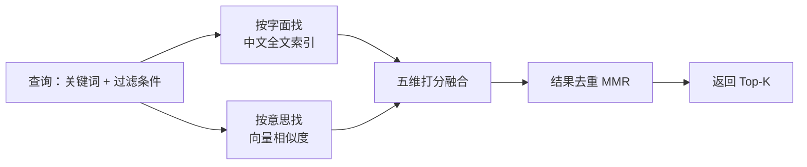

# 记忆中枢 · Memory Hub

> **语言 / Language**：[简体中文](README.md) · [English](README.en.md)

**给一堆 AI 助手共用的一本长期记忆账本：记得住、查得到、分得清、丢不了。**

[](https://www.rust-lang.org)
[](https://doc.rust-lang.org/edition-guide/rust-2021/index.html)
[](https://github.com/orderye/memory-hub/actions/workflows/ci.yml)
[](https://github.com/orderye/memory-hub/actions/workflows/ci.yml)
[](https://modelcontextprotocol.io/)
[](https://www.postgresql.org/)
[](LICENSE-MIT)

[](https://www.kimi.com/code) [](https://github.com/deepseek-ai/deepseek-harness)

用一句大白话说：**AI 助手一关窗口就失忆，这个服务负责把该记住的东西存起来，下次接着用。**

它对外是一个标准 MCP 服务，Claude Desktop、Cursor、Cline、LangChain 之类的 Agent 框架都能直接接上；
内部管好了四件事——**存取、备份、整合、演化**。

> **它不做什么（很重要）**：不往记忆里塞 Prompt 规范，也不替 Agent 做推理决策。
> 它只保证"返回的记忆是真实、结构化、带证据的"，怎么用是 Agent 自己的事。

---

## 目录

- [一、它解决什么麻烦](#一它解决什么麻烦)
- [二、整体长相：三个进程 + 一个数据库](#二整体长相三个进程--一个数据库)
- [三、快速开始](#三快速开始)
- [四、记忆是怎么组织的](#四记忆是怎么组织的)
- [五、检索是怎么工作的](#五检索是怎么工作的)
- [六、安全与可靠性](#六安全与可靠性)
- [七、MCP 工具清单（28 个）](#七mcp-工具清单28-个)
- [八、项目结构](#八项目结构)
- [九、开发、测试与质量门禁](#九开发测试与质量门禁)
- [十、已知限制与下一步](#十已知限制与下一步)
- [十一、文档导航](#十一文档导航)

---

## 一、它解决什么麻烦

让 Agent 长期记住事情，坑基本都在这几处。下面是"麻烦"和"这个服务怎么处理"的对照：

| 常见麻烦 | Memory Hub 的做法 |
| :--- | :--- |
| **助手一关窗口就忘了** | 记忆存在服务端（PostgreSQL），换个会话、换台机器都能接着查 |
| **好几个助手各记各的，重复还互相矛盾** | 整合中枢自动扫出"重复"与"冲突"，能自动合并，也能生成提案交给人裁决 |
| **老信息被翻出来当新信息用** | 记忆带有效期（`valid_from` / `valid_until`）。新事实取代旧事实时，旧的那条自动"过期封存"，检索默认不返回它 |
| **模型编造事实、编造代码改动** | 写入前先把原始材料存成**只增不改的证据**（`memory_evidence`）；代码只认真实 Git diff，不认模型口述 |
| **在这台机器上管用的经验，换台机器就闯祸** | 经验条目带适用环境标签（如 `linux`、`k8s`）。检索时环境对不上会**显式告警并降权** |
| **多租户/多用户数据互相看得见** | 以"账户"为硬边界做沙箱：即使两个账户用了同名的命名空间，数据也完全隔离（有测试守着，越权次数必须是 0） |
| **记忆库用久了变慢、越查越乱** | 关键词 + 语义双路检索、相似结果去重、向量服务挂了自动降级为关键词检索，检索接口不会挂死 |

### 一句话定位

不做"又一个 Agent 框架"，只做**基础设施**：一个可以被多个 Agent 共享、按账户隔离、可备份可恢复的记忆底座。

---

## 二、整体长相：三个进程 + 一个数据库

| 进程 | 对外形态 | 它管什么（打个比方） |
| :--- | :--- | :--- |
| **`mcp-server`** | HTTP `:3000`（端点 `/mcp`），也支持 stdio | 图书馆前台：接收记忆读写与检索请求，对外提供 28 个 MCP 工具 |
| **`auth-server`** | HTTP `:8080`，带网页控制台 | 门卫 + 办证处：注册账户、登记 Agent、发令牌（OAuth 2.1） |
| **`backup-worker`** | 后台常驻 + 定时任务 | 夜班管理员：定时做备份快照、清理过期记忆、离线扫描重复与冲突 |
| **PostgreSQL 15 + pgvector** | 数据文件 | 仓库本体（本地开发可以换成纯内存模式，重启即失忆，仅用于调试） |

三个进程都是**无状态**的，可以各自多开几份来扛量。


---

## 三、快速开始

### 两种部署形态：Personal Lite / Production Full

同一套代码、同一套数据库 schema、同一套备份格式，靠一个配置项选择**默认行为**：

| | Personal Lite（个人轻量） | Production Full（完整生产，默认） |
| :--- | :--- | :--- |
| 适用 | 单机、个人、少量 Agent | 团队 / 多账户 / 对外服务 |
| 进程 | postgres + auth-server + mcp-server | 再加**常驻** backup-worker |
| 嵌入 | `HUB_EMBED_PROVIDER=off`：不产生向量、不外呼任何嵌入服务 | `mock`（开发）或 `http`（真实语义） |
| 检索 | 纯关键词（FTS + 五维评分 + `min_score` 域外拒绝） | 关键词 + pgvector 语义召回 |
| 整合 | 纯本地规则（embedding 调用恒为 0） | 同左，可显式切 `hybrid` |
| 后台作业 | 手动 `backup-worker --once` | cron 备份 + 周期清理 + 跨副本租约 |
| 安全能力 | OAuth 2.1 / ACL / 账户隔离 / 备份恢复 **全部保留** | 同左 |

> **升级不会改变现有行为**：`HUB_DEPLOYMENT_PROFILE` 默认就是 `production`，
> 不设置它 = 今天的行为。Lite 只是"同一实现的另一组默认值"，不是另一套代码。

### 方式 A：Docker Compose 一键起（推荐）

```bash
git clone https://github.com/orderye/memory-hub.git && cd memory-hub

# 1. 复制配置模板
cp .env.example .env

# 2. 至少填两个必填项：
#    - HUB_TOKEN_SECRET：令牌签名密钥，至少 32 字节的随机串（两个服务必须一致）
#    - POSTGRES_PASSWORD：数据库口令（没填 compose 会直接拒绝启动）
#
# 3. 编译并启动全部 4 个容器（数据库 + 授权 + MCP + 后台任务）
docker compose up -d --build

# 4. 看状态、看日志
docker compose ps
docker compose logs -f mcp-server
```

起来之后直接打开 <http://localhost:8080/account/register> 注册账户，再进 <http://localhost:8080/console> 登记一个 Agent（拿到 `client_id` / `client_secret`）。

### 方式 A2：个人轻量部署（Lite）

```bash
# 1. 同样的 .env（至少填 HUB_TOKEN_SECRET 与 POSTGRES_PASSWORD）
cp .env.example .env

# 2. 起 Lite：不含常驻 backup-worker，嵌入默认关闭
docker compose -f docker-compose.lite.yml up -d --build

# 3. 需要时手动跑一轮后台作业（整合扫描 → 过期清理 → 证据清理 → 备份），跑完即退出
docker compose -f docker-compose.lite.yml run --rm backup-worker --once
```

Lite 下 `memory_search` 是**纯关键词检索**：响应的 `capabilities.keyword_only` 为 `true`，
`/capabilities` 里 `retrieval.vector_path_enabled=false`、`semantic.ready=false`。
想启用真实向量检索，在 `.env` 里显式配置 `HUB_EMBED_PROVIDER=http` +
`HUB_EMBED_ENDPOINT` + `HUB_EMBED_API_KEY` 后重启——**只有显式配置才会把记忆正文发往嵌入端点**。

### 方式 B：本地直接跑（开发调试）

本机没有 PostgreSQL 也不要紧，`memory://local` 是纯内存模式：

```bash
# 终端 1：授权服务
HUB_DB_URL=memory://local HUB_TOKEN_SECRET=dev-secret-at-least-32-chars-long \
  cargo run --bin auth-server

# 终端 2：MCP 服务
HUB_DB_URL=memory://local HUB_TOKEN_SECRET=dev-secret-at-least-32-chars-long \
  cargo run --bin mcp-server

# 终端 3（可选）：后台定时任务
HUB_DB_URL=memory://local HUB_TOKEN_SECRET=dev-secret-at-least-32-chars-long \
  cargo run --bin backup-worker
```

### 第一次调用：拿令牌 → 写一条 → 查出来

**第 1 步：机器 Agent 用 `client_credentials` 换令牌**

```bash
TOKEN=$(curl -s -X POST http://localhost:8080/oauth/token \
  -d "grant_type=client_credentials" \
  -d "client_id=agent-alpha" \
  -d "client_secret=your-agent-secret" \
  -d "scope=memory:write memory:read memory:admin" \
  | jq -r .access_token)

echo "拿到令牌：${TOKEN:0:16}..."
```

**第 2 步：写一条记忆**

MCP 端点是 `http://localhost:3000/mcp`，走标准 JSON-RPC。

```bash
curl -s -X POST http://localhost:3000/mcp \
  -H "Authorization: Bearer $TOKEN" \
  -H "Content-Type: application/json" \
  -d '{
    "jsonrpc": "2.0",
    "id": 1,
    "method": "tools/call",
    "params": {
      "name": "memory_put",
      "arguments": {
        "namespace": "infra-team",
        "key": "db-cluster-spec",
        "kind": "fact",
        "content": "生产数据库已升级到 PostgreSQL 16，启用 pgvector 向量索引",
        "tags": ["database", "infra", "pgvector"],
        "confidence": 0.98
      }
    }
  }' | jq .
```

**第 3 步：检索出来**

```bash
curl -s -X POST http://localhost:3000/mcp \
  -H "Authorization: Bearer $TOKEN" \
  -H "Content-Type: application/json" \
  -d '{
    "jsonrpc": "2.0",
    "id": 2,
    "method": "tools/call",
    "params": {
      "name": "memory_search",
      "arguments": {
        "namespace": "infra-team",
        "query_text": "生产数据库用的哪个版本？",
        "scene": "working",
        "top_k": 3
      }
    }
  }' | jq .
```

**第 4 步：整理 + 备份**

```bash
# 扫重复和冲突，高置信度的直接合并，其余生成提案
curl -s -X POST http://localhost:3000/mcp -H "Authorization: Bearer $TOKEN" \
  -H "Content-Type: application/json" \
  -d '{"jsonrpc":"2.0","id":3,"method":"tools/call","params":{"name":"memory_consolidate",
       "arguments":{"namespace":"infra-team","dry_run":false,"auto_merge":true}}}' | jq .

# 打一个不可变快照
curl -s -X POST http://localhost:3000/mcp -H "Authorization: Bearer $TOKEN" \
  -H "Content-Type: application/json" \
  -d '{"jsonrpc":"2.0","id":4,"method":"tools/call","params":{"name":"memory_backup_create",
       "arguments":{"namespace":"infra-team"}}}' | jq .
```

---

## 四、记忆是怎么组织的

### 1. 先存证据，再做结论

任何"从原始材料里提炼出的事实"，提炼之前都会先把原始材料原封不动存进 `memory_evidence`（只增不改）。
提炼出来的事实挂着证据 ID，于是任何一条记忆都能回答"你凭什么这么说"。

### 2. 每条记忆都有时间概念

- `occurred_at`：事情**真实发生**的时间（不是"什么时候记的"）；
- `valid_from` / `valid_until`：这条信息**在什么时候是对的**。

举个例子：主节点从 v1 换成 v2 后，系统会把 v1 那条的 `valid_until` 自动封口，检索默认只返回 v2。
想翻旧账时传 `include_superseded`，旧条目会带着降权系数一起返回——历史留痕，但不会干扰当前判断。

### 3. 三层认知记忆，各管各的

| 场景 | 管什么 | 关键点 |
| :--- | :--- | :--- |
| **Chat**（对话） | 事实 `Fact`、摘要 `Summary`、长期偏好 `Pattern`、待办意图 `Intention` | 意图带有效期，过期自动失效；"或许会 / 待定"这类含糊措辞在入库前就会被拒，防止"幻觉待办"；入库可选全自动、半自动或人工裁决 |
| **Working**（干活） | 单次任务 `WorkingFact` 与可复用经验 `Experience` 分开存 | 经验要过高门槛才配叫"经验"；带适用环境标签，环境不符会告警降权；用得好加分、踩过坑减分，分数太低自动标记弃用（不物理删除，留审计） |
| **Coding**（改代码） | 逻辑线程 `CodingThread` + 版本切片 `CodingRevision` | 只记**真实 Git diff**；同样的补丁重复写会幂等去重；顺手扫描私钥、Token 等敏感串并截断 |

### 4. 几个经常出现的词

| 词 | 通俗解释 |
| :--- | :--- |
| `namespace`（命名空间） | 一座"资料室"，比如 `infra-team`。第一个往里写的 Agent 自动成为它的负责人 |
| `key` | 资料室里的文件橱标签。同一个 `namespace` + `key` 再写一次就是**修订**，版本号自动 +1 |
| `kind` | 这条记忆是什么类型：事实 / 偏好 / 事件 / 技能…… |
| `scene` | 用在什么场景：`chat` / `working` / `coding`，检索时按场景收敛范围 |
| `layer` | 认知层级，结构化知识 > 原始观测，打分时给结构化知识更高先验 |
| `confidence` | 置信度 0~1，越靠得住越优先 |
| `ttl_seconds` | 过期时间，到点自动归档（不是删除） |

---

## 五、检索是怎么工作的

检索这件事，可以想象成一个图书管理员：

1. **两条路一起找**：一条按**字面**找（中文全文索引，自带分词，不依赖外部分词库），一条按**意思**找（向量相似度，pgvector HNSW 索引）；
2. **过滤条件下推到存储层**：场景、层级、有效期、状态、标签这些条件在取候选时就过滤掉，不浪费打分；
3. **五维打分排序**：五项加权求和，公式见下；
4. **结果去重（MMR）**：相似内容不会一起挤满前几名，把名额让给真正不同的信息；
5. **坏了也不趴窝**：向量服务故障 → 自动退化成纯关键词检索；查询超时 → 保留已经拿到的那一路结果；两路都没结果才走游标列表兜底。

打分公式（语义相似、关键词命中、置信度、新鲜度、层级先验五项加权求和）：

$$\text{Score} = w_{sim}\cdot\text{语义相似} + w_{kw}\cdot\text{关键词命中} + w_{conf}\cdot\text{置信度} + w_{rec}\cdot\text{新鲜度} + w_{prior}\cdot\text{层级先验}$$

两个容易讲错的地方：

- **关键词命中按"池内 IDF"加权**：稀有的词更有分量，`api` 不会莫名其妙命中 `rapid`；
- **新鲜度以"事件时间"为准**（不是更新时间），且按记忆类型区分衰减速度：偏好 180 天 / 技能 90 天 / 事实 60 天 / 事件 14 天 / 笔记 7 天；权重与时间常数都能用环境变量覆盖（`HUB_SCORE_WEIGHTS`、`HUB_RETRIEVAL_RECENCY_TAU_DAYS`），也支持按场景单独配一套权重。

### 没有可靠匹配，就说没有

检索有一条**默认拒绝阈值** `HUB_RETRIEVAL_MIN_SCORE`（默认 0.65）：低于这个分的候选一律丢弃。
一条都不剩时，工具返回 `{"results": [], "no_reliable_match": true}`——
**明确告诉调用方"没找到可靠的"**，而不是硬凑一条低分结果。

对长期记忆来说这两者的差别很大：域外问题硬凑一条结果，Agent 就会把它当事实依据，
轻则答非所问，重则把错误事实写进记忆。阈值也可以按场景单独配
（`HUB_SCENE_MIN_SCORE_PROFILES="chat=0.70;working=0.60"`），或由调用方显式传 `min_score` 覆盖。

> 阈值是在**伪向量**（纯词法）模态下标定的，换上真实嵌入模型后必须重新标定。
> 标定曲线怎么跑，见 [`docs/upgrade/EVALUATION.md`](docs/upgrade/EVALUATION.md)。

### 语义能力是否就绪，健康检查里说了算

伪向量嵌入器（`HUB_EMBED_PROVIDER=mock`）的余弦相似度是**噪声**，不是语义。
系统在启动时就会识别出来，并且：

- **不把向量维度混进打分**：该维度按"不可用"处理并对剩余维度重新归一化
  （配置权重**不动**，换上真实模型后该维度自动恢复参与，权重仍是配置值）；
- **在健康检查里如实声明**：`GET /readyz` 与 `GET /capabilities` 返回
  `semantic.ready` 与原因说明，不会把"词法检索"伪装成"语义检索"；
- **启动时打醒目告警**，避免"接口能返回结果 = 语义检索可用"的误判。



### 实测数据（评测基线 Bench v2）

评测集是**程序化生成、固定时钟、可复现**的：60 个主题、**480 条文档 / 600 条查询**，
覆盖精确命中、语义改写、时间演化、场景区分、环境边界与噪声负例，数据集指纹 `9f5b3b075a558371`。

```bash
# 跑检索评测（默认用确定性伪向量，只检测管道与排序逻辑回归）
cargo test --test eval_bench -- --nocapture
# 冻结/更新基线
HUB_EVAL_WRITE_BASELINE=1 cargo test --test eval_bench
# 消融实验（逐信号权重 / MMR λ / 新鲜度 τ / 场景偏好）
HUB_EVAL_ABLATIONS=1 cargo test --test eval_bench -- --ignored --nocapture
# 阈值标定：扫描 min_score，输出"域外拒绝对 / 域内召回"的权衡曲线
HUB_EVAL_CALIBRATE=1 cargo test --test eval_bench -- --ignored --nocapture
# 用真实嵌入服务评测（语义验收必须走这条）
HUB_EVAL_EMBED_ENDPOINT=https://…/v1/embeddings HUB_EVAL_EMBED_MODEL=bge-m3 \
  HUB_EVAL_REQUIRE_SEMANTIC=1 cargo test --test eval_bench -- --nocapture
```

当前冻结基线（**伪向量模态**，含默认拒绝阈值 `min_score=0.65`）：
Recall@1 68.15% / Recall@5 95.37% / Recall@10 97.22% / MRR@10 0.7989 / nDCG@10 0.6649，
硬负例违规率（Top-3）19.63%、**首位误取率 0.56%**、**域外误召回率 0.00%**，
进程内 p50 ≈ 10.1ms、p95 ≈ 28.4ms。

> **别被基线数字骗了**：这一轮用的是 Mock 伪向量，**语义维度在伪向量下是噪声**——
> 系统现在会**自动识别**伪向量嵌入器并把向量维度排除在打分之外（配置权重不变，
> 换上真实模型后该维度自动恢复参与），所以这些数字只证明"管道和词法排序没有回归"，
> **不能当作语义能力结论**。基线文件里 `semantic_ready: false` 就是这个标记。
> 接入真实嵌入模型后需要用 `HUB_EVAL_EMBED_*` 重跑并重新冻结基线。
> 完整的口径、分层指标与消融结果见 [`docs/upgrade/EVALUATION.md`](docs/upgrade/EVALUATION.md)。

### 门禁分三层：相对门禁不够用

| 层 | 判定依据 | 抓什么问题 |
| :--- | :--- | :--- |
| **相对门禁** | 与冻结基线逐查询配对比较（Δ > 1pt 且 \|z\| ≥ 2） | 指标**退化** |
| **绝对门禁** | 域外误召回率 ≤ 10%；首位误取率 ≤ 2% | 长期存在的缺陷（不随版本变化，相对门禁永远抓不到） |
| **业务正确性门禁** | 时间有效性 / 场景 / 标签 / 层级 / 环境边界**零违规** | 硬错误，与排序质量无关 |

"比上次没变差"不等于"够好"：一个本身就很弱的基线不发生退化时，测试照样通过。
所以域外误召回率、首位误取率与业务约束都设了**绝对**判定，不看基线。

质量门禁本身也做了防误报设计：基线里保存**每条查询的逐条结果**，回归判定按查询 ID 配对计算
差值 Δ 与显著性 z，要求"Δ 超过 1 个百分点 **且** |z| ≥ 2"才算退化；样本覆盖率不足或数据集指纹、
嵌入器不一致、**评测配置不一致**时直接判"不可比"，而不是稀里糊涂地比。

---

## 六、安全与可靠性

### 账户隔离与授权

- **账户即沙箱**：账户 A 与账户 B 就算建了同名命名空间，数据、授权、备份也完全隔离，越权检索有测试卡着 0 次；
- **标准 OAuth 2.1**：动态客户端注册（RFC 7591）、强制 PKCE S256、刷新令牌轮换与重放检测、受众绑定（RFC 8707）；
- **命名空间级授权**：谁的空间谁能读写，可以单独把某个空间授权给另一个 Agent，也能随时撤销（立即生效）；
- **三种权限范围**：`memory:read` / `memory:write` / `memory:admin`，每个工具都要声明自己需要哪一级。

### 记忆整合的两种候选发现模式（A / B）

整合中枢负责把"多 Agent 写重了"的记忆收拾干净。它有两种**候选发现**模式，
但**共用同一套判定与合并逻辑**——模式只影响"从哪找候选"，不影响"能不能合"。

| 模式 | 配置 | 候选从哪来 | 嵌入调用 | 记忆内容出站 |
| :--- | :--- | :--- | :--- | :--- |
| **B 纯本地规则**（默认） | `HUB_CONSOLIDATION_MODE=rules` | 规范化指纹、结构化字段（业务键/场景/标签/环境）、本地词法索引 | **恒为 0** | **否** |
| **A 向量辅助** | `HUB_CONSOLIDATION_MODE=hybrid` | B 的候选 **∪** 嵌入向量召回的语义候选 | 按需、有界、可计数 | 视嵌入端点而定 |

- **默认是 B**：即使配了 `HUB_EMBED_PROVIDER=http`，整合也不会自动调用向量服务——
  要不要把记忆内容发出去必须由管理员显式决定；
- **A 只是"向量帮你找候选"**：余弦相似度高只能说明"这两条值得一起看"，
  说不了"这两条相同"。`PostgreSQL 15` 和 `PostgreSQL 16` 语义很像，但它们是不同事实，
  绝不能合。**只有原文完全相同、或保守规范化后完全相同**的记忆才允许自动合并，
  语义近重复一律只出待审提案；
- **规范化是保守的**：只折叠空白、换行与 Unicode 兼容形式；
  大小写、否定词、数字、单位、日期、版本号、路径、URL 一律保留
  （"不是 X" 与 "X"、"v1" 与 "v2" 绝不会落到同一个指纹）；
- **降级是显式可见的**：`HUB_CONSOLIDATION_FALLBACK=rules` 时，向量不可用就降级为规则模式，
  响应里如实写明 `requested_mode=hybrid` / `effective_mode=rules` / `fallback_applied=true`，
  不会把降级结果伪装成成功的向量整合；`=error` 则直接失败，不执行任何整合；
- **整合与检索互不干扰**：整合模式不改变 `memory_search` 的检索模式、分数与 MMR；
  整合模式 B 也**不等于**"全系统离线"（检索与认知提炼是否调用模型是另一回事）；
- 健康检查里 `semantic`（检索语义能力）与 `consolidation`（整合模式）是**分开报**的。

```bash
# 默认就是 B：不发任何嵌入请求
HUB_CONSOLIDATION_MODE=rules

# 想用 A：先只预演，观察候选质量
HUB_CONSOLIDATION_MODE=hybrid
HUB_EMBED_PROVIDER=http
HUB_EMBED_ENDPOINT=https://embed.example.com/v1/embeddings
HUB_EMBED_MODEL=bge-m3
```

细节见 [`docs/upgrade/CONSOLIDATION_AB.md`](docs/upgrade/CONSOLIDATION_AB.md)。

### 备份与恢复

- **只读快照**：单个命名空间或整个账户（`*`）都能打快照，带 SHA-256 校验和，建完就改不了；
- **三种恢复姿势**：`dry_run` 先预演看看会变成什么样；`merge` 增量并入（推荐）；`replace` 整体替换——**替换前会强制先给当前数据打一份安全备份**，防止误操作把库清空；
- **恢复前先验校验和**，对不上直接拒绝恢复。

---

## 七、MCP 工具清单（28 个）

`memory_*` 18 个是基础盘，`cognitive_*` / `working_*` / `coding_*` 10 个是认知增强。

### 1. 基础存取（4 个）

| 工具 | 权限 | 干什么 |
| :--- | :--- | :--- |
| `memory_put` | `memory:write` | 写入或修订（同 `namespace` + `key` 自动版本 +1） |
| `memory_get` | `memory:read` | 按 ID 或业务键取一条 |
| `memory_update` | `memory:write` | 改部分字段（内容 / 标签 / 元数据 / 置信度 / TTL） |
| `memory_delete` | `memory:write` | 软删除：归档但保留全部历史 |

### 2. 检索与统计（4 个）

| 工具 | 权限 | 干什么 |
| :--- | :--- | :--- |
| `memory_search` | `memory:read` | 混合检索。可传 `scene`、`layer`、`valid_at`、`include_superseded`、`min_score` |
| `memory_list` | `memory:read` | 按条件列举，游标分页 |
| `memory_stats` | `memory:read` | 命名空间统计（总量、状态、类型分布、24 小时内到期数） |
| `memory_history` | `memory:read` | 一条记忆的完整版本变更史 |

### 3. 整合与提案治理（5 个）

| 工具 | 权限 | 干什么 |
| :--- | :--- | :--- |
| `memory_consolidate` | `memory:write` | 一键整理：查重、查冲突、评陈旧度、按策略合并。可选 `mode` 参数切换候选发现模式（默认禁止逐请求覆盖） |
| `memory_consolidation_stats` | `memory:read` | 整合健康度（重复组数、冲突组数、陈旧条目、冗余率、健康分） |
| `memory_integrate_scan` | `memory:write` | 扫描并生成待审提案（已有 open 提案的组会自动跳过）。可选 `mode` 参数，语义同上 |
| `memory_integration_list` | `memory:read` | 列出待处理提案 |
| `memory_integration_resolve` | `memory:write` | 裁决提案：`merge` 合并保留溯源 / `dismiss` 保持分立 |

### 4. 备份与恢复（3 个）

| 工具 | 权限 | 干什么 |
| :--- | :--- | :--- |
| `memory_backup_create` | `memory:admin` | 打不可变快照（某命名空间或 `*` 全量），生成 SHA-256 校验和 |
| `memory_backup_list` | `memory:admin` | 列出快照与体积 |
| `memory_restore` | `memory:admin` | 恢复：`dry_run` / `merge` / `replace`（replace 前自动安全备份） |

### 5. 权限管理（2 个）

| 工具 | 权限 | 干什么 |
| :--- | :--- | :--- |
| `memory_grant` | `memory:admin` | 把自己的命名空间授权给别的 Agent |
| `memory_revoke` | `memory:admin` | 撤销授权，立即生效 |

### 6. 认知增强（10 个）

| 工具 | 权限 | 干什么 |
| :--- | :--- | :--- |
| `cognitive_chat_propose` | `memory:write` | 把多轮对话丢进来做认知提炼（候选事实、实体关联、整合提案） |
| `cognitive_proposal_resolve` | `memory:write` | 审核认知提案：采纳 / 驳回 / 编辑后合并 |
| `cognitive_intentions_list` | `memory:read` | 列出当前意图与候选提案（看有没有过期意图） |
| `working_task_start` | `memory:write` | 开一项工作流任务，可关联证据 |
| `working_task_finish` | `memory:write` | 结束任务，记录结果摘要或失败原因 |
| `working_experience_distill` | `memory:write` | 把一个任务或复盘沉淀成经验（含前置条件、边界环境、已知失败模式） |
| `working_experience_feedback` | `memory:write` | 给经验打分反馈（+1 有效 / -1 踩坑），可顺带改生命周期状态 |
| `working_experience_search` | `memory:read` | 检索可复用经验，带当前环境做边界匹配，不匹配会告警降权 |
| `coding_thread_create` | `memory:write` | 建一条代码演进/重构逻辑线程 |
| `coding_revision_record` | `memory:write` | 记录一次代码修订（真实 diff、变更类型、安全相对路径、符号指纹） |

---

## 八、项目结构

标准 Rust Workspace，按职责分层：

```text
.
├── Cargo.toml                  # Workspace 与统一依赖
├── Dockerfile                  # 多阶段构建的生产镜像
├── docker-compose.yml          # 一键编排（DB + 三个服务）
├── .cnb.yml                    # CNB 云构建：main push 出镜像并部署；tag push 出定版镜像；tag 部署触发器
├── .cnb/tag_deploy.yml         # CNB 自定义部署环境：Tag 详情页「部署」选 production
├── .github/workflows/ci.yml    # GitHub Actions：质量门禁 / PG 集成 / 依赖审计 / Release 构建
├── scripts/push-cnb.sh         # 双平台推送：以 CNB 身份重放并推送镜像（patch-id 口径）
├── scripts/ci/deploy-production.sh  # 生产部署阶段（切镜像 / 探活 / 失败回滚），CNB 两条流水线共用
├── docs/                       # 设计与规范文档（见第十一节）
└── crates/
    ├── common/                 # 公共部件：配置强校验、脱敏日志、限流、Cron、整合模式枚举
    ├── mem-core/               # 领域核心：记忆与备份模型、权限、认知领域服务、内容指纹
    ├── consolidation/          # 整合中枢：候选发现（规则 / 向量）、关系分类、分级融合、自动调度
    ├── store/                  # 存储：PostgreSQL 迁移 + 纯内存双后端
    ├── embed/                  # 嵌入：OpenAI 兼容 HTTP 客户端 + 确定性 Mock
    ├── retrieval/              # 检索：中文分词、双路召回、五维打分、MMR
    ├── authz/                  # 鉴权：HS256 验签、受众校验、受保护资源元数据
    ├── auth-core/              # OAuth 原语：PKCE S256、令牌家族轮换、Argon2
    ├── auth-web/               # 授权服务：DCR、OAuth 端点、账户控制台
    ├── mcp/                    # MCP 协议层：28 个工具 Schema、HTTP / stdio 传输
    ├── worker/                 # 后台任务：定时快照、过期清理、离线扫描
    └── bins/                   # 三个可独立部署的二进制
        ├── mcp-server/
        ├── auth-server/
        └── backup-worker/
```

---

## 九、开发、测试与质量门禁

```bash
# 完整测试套件（当前默认特性下 485 个用例，0 失败；含契约快照与轻量化用例）
cargo test --workspace

# 静态检查（零警告门禁）
cargo clippy --workspace --all-targets -- -D warnings

# 格式检查
cargo fmt --all -- --check

# 检索评测基线（排序质量；不得因本次改动退化）
cargo test --test eval_bench -- --nocapture

# 整合评测（整合质量：错误合并数、硬约束违规数、B 模式 embedding 调用数必须为 0）
cargo test --test consolidation_eval -- --nocapture

# 真实 PostgreSQL 集成测试（需要 DATABASE_URL 指向测试库）
cargo test -p store --features pg-integration -- --ignored
```

CI 分两条：

- **GitHub Actions**（`.github/workflows/ci.yml`）：① 质量门禁（fmt / clippy `--all-features` / 测试 / 文档构建）；
  ② PostgreSQL + pgvector 真实库集成测试（串行执行）；③ 依赖准入与安全审计（cargo-deny + cargo-audit）；④ Release 构建三个二进制。
- **CNB 云构建**（`.cnb.yml`）：push 到 `main` 触发——云端构建镜像 → 推制品库 → SSH 部署到服务器 →
  探活 `/readyz`，失败自动回滚到上一稳定版本。其它分支 push 走 `$` 兜底流水线，只跑质量门禁
  （fmt / clippy / test），不构建镜像、不碰生产；连续多次 push 由流水线锁排队，不会并发部署。
  打 tag 走同一条 `$` 兜底键下的 `tag_push`：把该 tag 的提交打成 `:<tag 名>` 定版镜像入库，
  不部署、也不改动 `latest`（上线仍只由 `main` push 负责）。
  另外可在 **Tag 详情页 →「部署」→ 选 `production`** 手动上线或回滚到某个已发布的 tag
  （`tag_deploy.production`，环境与权限在 `.cnb/tag_deploy.yml`）。

### 手动部署 / 按 tag 回滚（CNB 部署触发器）

`main` push 仍是默认上线方式；需要**指定版本上线或回滚**时走部署页：

1. 先让目标版本有定版镜像：推 tag（双端分别打，见 [`docs/upgrade/PUSH_PROCESS.md`](docs/upgrade/PUSH_PROCESS.md) §5.2），
   `tag_push` 会产出 `memory-hub:<tag 名>`；
2. CNB 仓库页 → Tag 列表 → 打开该 tag →「部署」→ 选 `production` → 确认；
3. 流水线依次执行：取定版镜像并固化 digest → 部署 → `/readyz` 探活，失败自动回滚到上一稳定版本。

三条边界：

- 流水线配置来自**该 tag 提交里的** `.cnb.yml` / `.cnb/tag_deploy.yml`，早于本功能的老 tag 没有部署入口；
- 定版镜像不存在时部署直接失败并提示，不会现场重新构建——避免部署的镜像与发布制品不是同一个 digest；
- 部署与 `main` 发布共用一把锁（`deploy-main`）；两条入口都会改写服务器的
  `current_release.env` / `previous_release.env`，并发执行会让回滚基准指向错的镜像。

### 云原生开发环境（CNB）

不装本地工具链也能开工：CNB 仓库页 →「云原生开发」/ IDE，选分支启动即可（`$: vscode` 事件，
基础镜像定义在 `.ide/Dockerfile`）。首次启动要构建镜像（拉 `rust:1-bookworm` + code-server），
约 5–10 分钟；之后命中镜像层缓存。

- **镜像里已有**：Rust 工具链（stable）与 `cargo clippy` / `cargo fmt`、`build-essential` + `pkg-config`
  （`tikv-jemalloc-sys` 需要 C 编译）、`psql`、`jq` / `ripgrep`、Docker CLI，以及 `code-server`
  与 rust-analyzer 等插件。镜像装了 code-server，所以是单容器模式：浏览器里的终端就是本镜像。
- **依赖缓存**：`/usr/local/cargo/registry` 与 `target/` 走数据卷，只在当前构建节点内有效，换节点自动失效。
- **配置**：启动阶段会在缺少时把 `.env.example` 复制成 `.env`（已存在则不动），仍需自己填
  `POSTGRES_PASSWORD` / `HUB_TOKEN_SECRET`。
- **真库联调**：`docker compose up -d postgres` 起 `pgvector/pgvector:pg15`，
  再按「方式 B」设置 `HUB_DB_URL` 后跑 `cargo test -p store --features pg-integration -- --ignored`。
- **改环境**：改 `.ide/Dockerfile` 或 `.cnb.yml` 的 `$: vscode` 段，提交后用
  `./scripts/push-cnb.sh --push` 同步到 CNB。`build.by` 只认 `.ide/Dockerfile`，源码改动不会触发镜像重建。

### 回滚（应用版本 / 部署形态）

本轮升级**没有新增数据库迁移**，Lite 与 Production 共用同一 schema、同一备份格式，
因此回滚只涉及二进制/镜像，不需要数据库回滚：

```bash
# 1. 应用版本回滚：回到上一个稳定 tag/commit，重新构建并重启
git checkout <上一个稳定 tag 或 commit>
docker compose up -d --build                              # Production
docker compose -f docker-compose.lite.yml up -d --build    # Lite

# 2. 只回滚\"部署形态\"：把 HUB_DEPLOYMENT_PROFILE 改回 production 并重启，
#    数据、账户、权限、备份全部不动（profile 只影响默认值）
```

备份/恢复的验证方式（`dry_run` 必须零写入、校验和不符必须拒绝恢复、
`replace` 前必须自动生成安全备份）见
[`docs/upgrade/LIGHTWEIGHT_EXECUTION_REPORT.md`](docs/upgrade/LIGHTWEIGHT_EXECUTION_REPORT.md)。

> [!NOTE]
> **路径里带空格的坑**：如果代码检出在含空格的目录（比如某些外挂盘），请用 `cargo test --workspace`，
> **不要**加 `--all-features`——可选特性 `tikv-jemalloc-sys` 的构建脚本不支持带空格的前缀路径；
> 默认内存分配器在各平台上完全够用。详见 [`docs/upgrade/REPOSITORY_AUDIT.md`](docs/upgrade/REPOSITORY_AUDIT.md)。

---

## 十、已知限制与下一步

写在这里是为了不让人踩坑，而不是自夸：

1. **生产必须接真实嵌入模型**。`HUB_EMBED_PROVIDER=mock` 的伪向量只是让开发/测试可复现，语义能力为零；
   接了 `http` 提供方之后要按评测流程重新冻结基线。
   语义能力是否就绪**在健康检查里如实暴露**：`GET /readyz` 与 `GET /capabilities`
   返回 `semantic.ready` 与原因说明，不会把"词法检索"伪装成"语义检索"。
2. **默认拒绝阈值是在伪向量下标定的**。`HUB_RETRIEVAL_MIN_SCORE` 默认 0.65，
   作用是把域外误召回率压到 0%（原来 100%），代价是 Top-3 硬负例占比偏高
   （19.63%，但**首位**误取率仅 0.56%）。换上真实嵌入模型后**必须重新标定**：
   跑 `HUB_EVAL_CALIBRATE=1` 拿新曲线再定值。
3. **阈值仍需外部标注**：冲突/重复判定的阈值、以及 Chat 认知提炼的真实 LLM 抽取器，都还缺真实资源来校准。
4. **`temporal` / `paraphrase` / `env` 三类查询是当前短板**，需要真实嵌入模型介入后复测排序质量。
5. **证据不可变 ≠ 写前不能脱敏**：凭证扫描、敏感片段掩码、最小化摘要与保留期限都在**写入前/到期清理**
   两道关卡上完成，详见 [`docs/upgrade/CHAT_MEMORY.md`](docs/upgrade/CHAT_MEMORY.md)。
6. **整合默认不再使用向量**：`HUB_CONSOLIDATION_MODE` 默认 `rules`（纯本地规则整合），
   即使配了真实嵌入服务也不会自动启用向量整合；A 模式的语义增益需真实模型 +
   `cargo test --test consolidation_eval` 才能验收，详见
   [`docs/upgrade/CONSOLIDATION_AB.md`](docs/upgrade/CONSOLIDATION_AB.md)。

7. **认知异步作业尚未装配**：`ChatCognitiveJob`（会话提炼重试）与 `ExperienceDistillJob`（经验提炼）
   已实现并有测试，但**没有接进任何二进制的调度**——真实 LLM 抽取器尚未接入，
   接进去只会用 Mock 抽取器产出占位数据。等真实抽取器落地后再装配。
8. **定时备份的快照是 v1 载荷**：`backup-worker` 的周期快照只包含记忆条目，
   `memory_backup_create` 走的是 v4 载荷（含证据、关系、任务、经验、代码线程）。
   恢复路径同时支持 v1–v4，但没有证据链的定时快照不能当作完整备份使用。
9. **多副本只保证\"不同副本重复执行\"被租约挡住**（`HUB_JOB_LEASE_H`），
   不保证单副本内部的扫描进度可续传；大命名空间请用 `HUB_INTEGRATION_SCAN_MAX_ENTRIES` 分批。

---

## 十一、文档导航

| 想了解 | 看这个 |
| :--- | :--- |
| 文档总入口、演进史、阅读路径 | [`docs/README.md`](docs/README.md) |
| 系统总体设计规格与工具契约 | [`docs/设计-多智能体长期记忆服务.md`](docs/设计-多智能体长期记忆服务.md) |
| 认知升级总纲（P0–P5 实施要求） | [`docs/Memory_Hub_Cognitive_Upgrade_Agent_Brief.md`](docs/Memory_Hub_Cognitive_Upgrade_Agent_Brief.md) |
| 对话记忆四层模型 | [`docs/upgrade/CHAT_MEMORY.md`](docs/upgrade/CHAT_MEMORY.md) |
| 经验记忆与环境边界 | [`docs/upgrade/WORKING_MEMORY.md`](docs/upgrade/WORKING_MEMORY.md) |
| 代码演进链与真实 Diff | [`docs/upgrade/CODING_MEMORY.md`](docs/upgrade/CODING_MEMORY.md) |
| 检索评测、基线与消融 | [`docs/upgrade/EVALUATION.md`](docs/upgrade/EVALUATION.md) |
| 记忆整合 A/B 双模式（候选发现、合并门槛、评测） | [`docs/upgrade/CONSOLIDATION_AB.md`](docs/upgrade/CONSOLIDATION_AB.md) |
| 双平台推送流程（GitHub + CNB 身份隔离与重放） | [`docs/upgrade/PUSH_PROCESS.md`](docs/upgrade/PUSH_PROCESS.md) |
| 质量与安全基线 | [`docs/upgrade/BASELINE.md`](docs/upgrade/BASELINE.md) |
| 仓库与构建环境审计 | [`docs/upgrade/REPOSITORY_AUDIT.md`](docs/upgrade/REPOSITORY_AUDIT.md) |
| 业务系统零侵入接入方案 | [`docs/创界山智能接入层实施方案.md`](docs/创界山智能接入层实施方案.md) |

> **文档语言**：`docs/` 下的专题文档目前**仅提供中文版**；本 README 提供中英双版本
> （[English](README.en.md)），其余文档可按需补充。

---

## 📄 License

MIT OR Apache-2.0 双协议，任选其一：[MIT](LICENSE-MIT) / [Apache-2.0](LICENSE-APACHE)。
