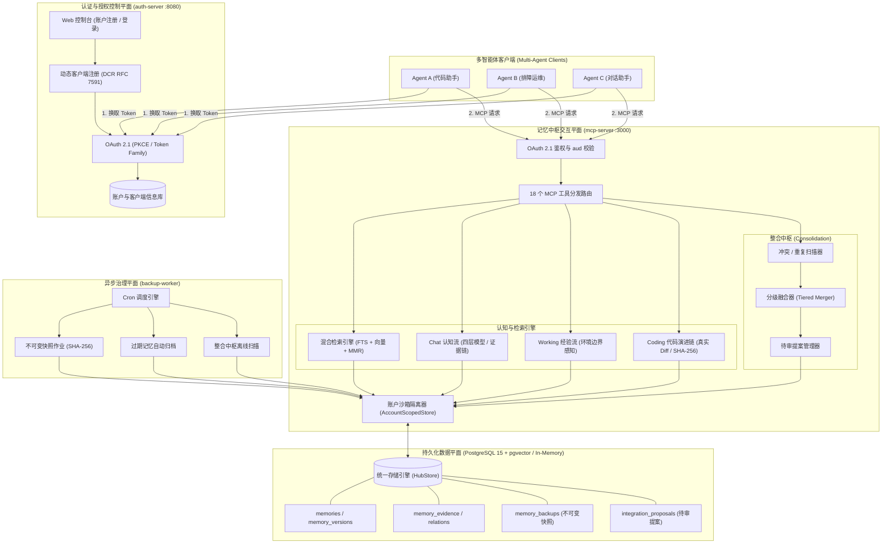
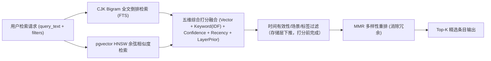

# 记忆中枢 · Memory Hub

**多智能体（Multi-Agent）长期记忆基础设施 · 认知分层架构 · OAuth 2.1 账户沙箱 · 18 记忆工具 MCP 服务**

[](https://www.rust-lang.org)
[](https://doc.rust-lang.org/edition-guide/rust-2021/index.html)
[]()
[]()
[](https://modelcontextprotocol.io/)
[]()
[]()

---

多个 AI Agent 共享一套工业级长期记忆：每个 Agent 以自己的身份（OAuth 2.1 客户端）受控存取记忆；数据按**命名空间（Namespace）**严格隔离与按需授权；底层构建**不可变快照备份**、**整合中枢去重与冲突合并**、以及**Chat / Working / Coding 三层认知记忆流**。

> **定位声明**：本服务只做记忆的**存取、备份、整合与认知演化**四件事——不内嵌任何生成式 Agent 的 Prompt 行为规范或自由推理；记忆中枢返回真实、结构化与具备证据链的上下文，推理决策始终属于 Agent 自身。

---

## 目录

- [核心特性](#-核心特性)
- [三大服务进程](#-三大服务进程)
- [架构拓扑与交互时序](#-架构拓扑与交互时序)
- [认知记忆分层系统](#-认知记忆分层系统)
- [快速混合检索引擎](#-快速混合检索引擎)
- [整合中枢与融合机制](#-整合中枢与融合机制)
- [账户沙箱与 OAuth 2.1 安全体系](#-账户沙箱与-oauth-21-安全体系)
- [MCP 工具集全景契约 (18 个)](#-mcp-工具集全景契约-18-个)
- [快速开始](#-快速开始)
- [一次完整调用示例](#-一次完整调用示例)
- [项目目录结构与 Crate 划分](#-项目目录结构与-crate-划分)
- [本地开发与验证基线](#-本地开发与验证基线)
- [文档导航矩阵](#-文档导航矩阵)
- [License](#-license)

---

## 🌟 核心特性

- **多账户沙箱隔离（Multi-Account Sandbox）**：以终端用户账户作为物理与逻辑沙箱边界。不同账户即使拥有同名命名空间，数据、授权与快照亦绝对隔离（Fail-Closed，跨租户泄露次数恒为 0）。
- **认知记忆垂直分层（Cognitive Architecture）**：
  - **不可变证据链**（`memory_evidence`）：写入抽取前先持久化原始上下文，确保决策完全可审计溯源；
  - **时间有效性与事实演化**（`valid_from <= t < valid_until`）：新事实通过 `supersedes` 关联自动闭合旧事实有效期，杜绝过期知识产生伪冲突；
  - **Chat 对话认知流**：四层模型（Fact / Summary / Pattern / Intention），意图过期自动失效，防止模型幻觉；
  - **Working 经验记忆**：任务事实与通用经验严格解耦，环境边界感知（`boundary_envs`，不匹配显式告警并降权），正负反馈闭环衰减；
  - **Coding 代码演进链**：真实 Git Diff 捕获、SHA-256 幂等重放、敏感凭证（Token/密钥）自动截断与过滤。
- **高性能混合检索（Hybrid Retrieval）**：
  - **双路并发召回**：CJK Bigram 零依赖中文全文倒排索引（FTS）与 pgvector HNSW 余弦向量相似度并发召回；过滤条件（场景/层级/时间有效性/状态/标签）下推到存储层，向量路在 pgvector ≥ 0.8 上自动启用 `hnsw.iterative_scan`；
  - **词法语义统一**：文档 / 查询 / 打分三处共用同一套分词（剔除"的数""们的"等低信息量功能 bigram），FTS 采用部分匹配（OR）并由 `ts_rank_cd` 排序，避免多词查询整条遗漏与"按更新时间截断候选池"；
  - **五维打分融合**：向量相似度、关键词命中（词元集合匹配 + 池内 IDF 稀有度加权，`api` 不再误命中 `rapid`）、条目置信度、近期性（**事件时间**优先，按记忆类型区分衰减常数）、认知层级先验；
  - **MMR 多样性重排**：通过 Maximal Marginal Relevance 算法降低信息冗余，防止相似条目占满上下文窗口；
  - **高可用容灾降级**：向量服务故障自动降级为 FTS 关键词检索，软超时（Soft Timeout）降级为列表兜底，保证检索永不挂起。
- **整合中枢引擎（Consolidation Engine）**：
  - 自动识别同 Key 事实分歧（Conflict）与语义高相似碎片（Duplicate）；
  - 分级融合器（Tiered Merger）：正文智能合并、Tag 并集融合、保留完整 `merged_from` 追溯链；
  - 自适应策略：支持人工审查提案（`Manual`）、高置信度轻量自动合并（`SemiAuto`）、以及全自动收敛归档（`FullAuto`）。
- **不可变快照备份与安全恢复（Backup & Restore）**：
  - 支持单命名空间或账户级全量（`*`）不可变快照，内置 SHA-256 校验和防篡改；
  - 三种恢复模式：`DryRun`（安全校验预演）、`Merge`（增量并入）、`Replace`（替换前**强制作业前安全备份**，杜绝误操作失忆）。
- **企业级安全与标准 OAuth 2.1**：
  - 动态客户端注册（RFC 7591 DCR，需账户持有人鉴权）；
  - PKCE S256 强制保护、Token Family 刷新令牌自动轮换与重放检测；
  - 资源指示器（RFC 8707 `aud` 严格受众绑定）与授权元数据协议（RFC 9728）。

---

## 🚀 三大服务进程

系统由 3 个无状态微服务二进制构成，均支持独立横向扩展：

| 二进制进程 | 协议 / 传输层 | 核心职责 |
| :--- | :--- | :--- |
| **`mcp-server`** | Streamable HTTP (`:3000`) / stdio | 记忆交互中枢：实现 18 个 MCP 工具协议、权限检查、混合检索与认知分层存取 |
| **`auth-server`** | HTTP / HTML 控制台 (`:8080`) | 认证与沙箱中枢：账户注册/登录/控制台 + OAuth 2.1（DCR、Token、PKCE、撤销与内省） |
| **`backup-worker`** | 后台守护进程 / Cron 调度器 | 异步维护中枢：按计划创建快照、清理过期记忆、扫描整合中枢重复与冲突提案 |

> **存储层**：生产环境采用 **PostgreSQL 15+ 与 pgvector**；本地开发与单元测试提供纯内存驱动（`HUB_DB_URL=memory://local`）。  
> **嵌入层**：支持 OpenAI 兼容 `/embeddings` 协议服务，或本地确定性 Mock 嵌入器。

---

## 🏛️ 架构拓扑与交互时序



---

## 🧠 认知记忆分层系统

为解决传统 Agent 记忆库“上下文膨胀、知识过期产生陈旧冲突、错误经验误导执行、代码历史靠模型幻觉推测”的行业痛点，Memory Hub 落地了三层专业认知子系统：

### 1. 不可变证据存根与时间图谱 (`P1`)
- **证据优先（Evidence First）**：在执行模型事实抽取前，先持久化原始交互数据至 `memory_evidence`（只增不减）。抽取生成的 Fact 深度关联 `evidence_id`，杜绝无据可依。
- **时间演化模型**：引入 `occurred_at`（事件物理时刻）、`valid_from` 与 `valid_until`（有效性区间）。当事实发生演进（如版本从 v1 升级为 v2），系统自动通过 `supersedes` 关系闭合旧事实的 `valid_until`，既保留演化轨迹，又防止旧事实干扰当前判断。

### 2. Chat 对话认知流 (`P2` · [规范文档](docs/upgrade/CHAT_MEMORY.md))
- **四层认知模型**：
  - `Fact`：客观配置与硬性事实（如“生产库域名为 db.internal”），挂载证据；
  - `Summary`：长对话里程碑摘要，压缩上下文；
  - `Pattern`：长期稳定的协作偏好（如“严格遵守 rustfmt 规范”）；
  - `Intention`：前瞻意图与计划（必须具备 `valid_until`，超期自动失效，禁止推测性无证据入库）。
- **审查机制**：支持 `Manual`（生成提案由人工裁决）、`SemiAuto`（高置信度自动入库）、`FullAuto`（全自动合并）。

### 3. Working 经验记忆系统 (`P3` · [规范文档](docs/upgrade/WORKING_MEMORY.md))
- **任务事实与通用经验严格解耦**：
  - `WorkingFact`：记录单次特定任务（输入、输出、耗时、执行状态）；
  - `Experience`：提炼可复用的排障方案或设计模式，需满足高通用性门槛。
- **环境边界感知（Boundary-Aware Recall）**：
  - 经验条目声明适用环境集合（如 `["linux", "k8s"]`）；
  - 检索若与当前运行环境不匹配，系统返回 `env_mismatch = true` 强警示并惩罚打分，严防跨环境套用导致灾难性误操作。
- **反馈衰减闭环**：支持根据执行结果追加正向/负向反馈；置信度低于阈值自动标记为 `Deprecated`，绝不物理硬删除，保留安全审计依据。

### 4. Coding 代码演进链 (`P4` · [规范文档](docs/upgrade/CODING_MEMORY.md))
- **真实 Diff 捕获**：禁止大模型自行凭空捏造补丁，代码修订源自真实 Git commit 或工作区真实 patch；
- **两级解耦**：`CodingThread` 承载业务逻辑主题（如“重构重试机制”），`CodingRevision` 承载具体文件的不可变差异切片；
- **安全与幂等**：内置 SHA-256 差异哈希，重复写入直接幂等重放；内置凭证敏感词扫描正则，私钥与 Token 自动拦截。

---

## 🔍 快速混合检索引擎

记忆中枢结合了倒排索引与高维向量语义，构建了工业级混合召回管道：



### 打分模型与场景过滤
$$\text{Score} = w_{sim} \cdot \text{VectorSim} + w_{kw} \cdot \text{KeywordHit} + w_{conf} \cdot \text{Confidence} + w_{rec} \cdot \text{Recency} + w_{prior} \cdot \text{LayerPrior}$$

- **候选池**：FTS 路按 `ts_rank_cd` 相关度排序取前 `HUB_RETRIEVAL_FTS_K`（默认 100）条，向量路按余弦距离取前 `HUB_RETRIEVAL_VEC_K`（默认 100）条后再融合——不再按 `updated_at` 截断，避免"更相关但更旧"的文档在打分前被丢弃；
- **关键词命中**：与 FTS 同源的分词词元集合匹配（非裸子串），并按候选池内 IDF 加权，稀有词元主导命中度；
- **近期性（Recency）**：以 `occurred_at`（事件时间）优先、`updated_at` 兜底，衰减时间常数按记忆类型区分（偏好 180 天 / 技能流程 90 天 / 事实 60 天 / 事件 14 天 / 笔记 7 天），`HUB_RECENCY_TAU` 可整体覆盖；
- **层级先验（LayerPrior）**：结构化知识优先于原始观测（Identity/Schema 1.0 > Knowledge/Fact 0.8 > Summary 0.6 > Raw 0.5）；
- **场景（Scene）**：指定 `scene` 时在存储层硬过滤（跨场景噪声不进入候选），命中条目另享 **+0.05** 加成；
- **MMR (Maximal Marginal Relevance) 重排**：`min_score` 阈值先于 MMR 应用，在相关性与多样性之间取得平衡；
- **全链路容灾**：向量服务不可用时降级为纯文本 FTS；查询嵌入与双路召回共享软超时预算，双路各自超时且已完成的一路结果保留；两路都无结果时才回退游标列表，检索接口永不悬挂。

---

## 🛠️ MCP 工具集全景契约 (18 个)

通过标准 Model Context Protocol 向各大 Agent 框架（Claude Desktop、Cursor、Cline、LangChain 等）暴露 18 个专业工具：

### 1. 基础记忆存取 (CRUD)
| 工具名称 | 权限 Scope | 描述与关键参数 |
| :--- | :--- | :--- |
| `memory_put` | `memory:write` | 写入记忆或 upsert（同 `namespace`+`key` 自动增加版本）。参数：`namespace`, `key`, `kind`, `content`, `tags`, `metadata`, `confidence`, `ttl_seconds` |
| `memory_get` | `memory:read` | 精确查询。参数：`id` 或 (`namespace` + `key`) |
| `memory_update` | `memory:write` | 字段局部修订。参数：`id`, `content`, `tags`, `metadata`, `confidence`, `ttl_seconds` |
| `memory_delete` | `memory:write` | 软删除（状态置为 archived，保留版本历史与演进溯源） |

### 2. 混合检索与统计
| 工具名称 | 权限 Scope | 描述与关键参数 |
| :--- | :--- | :--- |
| `memory_search` | `memory:read` | 混合检索。参数：`query_text`, `kinds`, `tags`, `top_k`, `min_score`, `scene`（chat/working/coding）, `layer`, `valid_at`（时效点断言）, `include_superseded` |
| `memory_list` | `memory:read` | 结构化条件筛选 + 游标分页（Cursor Pagination）。参数：`cursor`, `limit`, `status` |
| `memory_stats` | `memory:read` | 命名空间容量与健康度统计（活跃数、归档数、分类占比等） |
| `memory_history` | `memory:read` | 查询特定记忆条目的全量版本变更链（每次 put/update 修订轨迹） |

### 3. 整合中枢与提案治理
| 工具名称 | 权限 Scope | 描述与关键参数 |
| :--- | :--- | :--- |
| `memory_consolidate` | `memory:write` | 一键运行整合中枢：冲突扫描、重复判定、分级归并。参数：`dry_run`, `sim_threshold`, `auto_merge` |
| `memory_consolidation_stats` | `memory:read` | 整合指标监控：活跃条目、重复组数、冲突组数、平均相似度分布 |
| `memory_integrate_scan` | `memory:write` | 扫描重复/冲突并生成待审提案（Integration Proposal） |
| `memory_integration_list` | `memory:read` | 列举当前命名空间下的待处理合并/冲突提案 |
| `memory_integration_resolve` | `memory:write` | 显式裁决提案：`merge`（执行合并）或 `dismiss`（驳回忽略） |

### 4. 不可变快照备份与灾难恢复
| 工具名称 | 权限 Scope | 描述与关键参数 |
| :--- | :--- | :--- |
| `memory_backup_create` | `memory:admin` | 创建不可变快照（支持特定命名空间或账户全量 `*`），生成 SHA-256 校验和 |
| `memory_backup_list` | `memory:admin` | 查看快照清单、元数据与备份体积 |
| `memory_restore` | `memory:admin` | 灾难恢复。参数：`backup_id`, `mode`（`dry_run` / `merge` / `replace`，**replace 前强制自动生成安全备份**） |

### 5. 命名空间授权控制 (ACL)
| 工具名称 | 权限 Scope | 描述与关键参数 |
| :--- | :--- | :--- |
| `memory_grant` | `memory:admin` | 命名空间所有者将读/写权限授权给账户内的其他 Agent |
| `memory_revoke` | `memory:admin` | 撤销已授予的 Agent 权限，即刻生效 |

---

## ⚡ 快速开始

### 方式 A：Docker Compose 一键启动（推荐生产体验）

```bash
# 1. 克隆仓库并复制环境变量模板
cp .env.example .env

# 2. 至少配置强密钥（必须 >= 32 字符）
sed -i '' 's/HUB_TOKEN_SECRET=.*/HUB_TOKEN_SECRET=your-super-secure-token-secret-at-least-32-bytes/' .env

# 3. 一键编译并启动全部 4 个容器（DB + Auth + MCP + Worker）
docker compose up -d --build

# 4. 查看容器状态
docker compose ps
```

### 方式 B：本地直接运行（开发调试）

开发调试时，若本地暂无 PostgreSQL，可直接指定纯内存模式：

```bash
# 1. 终端 1：启动认证服务器 (:8080)
HUB_DB_URL=memory://local HUB_TOKEN_SECRET=dev-secret-at-least-32-chars-long cargo run --bin auth-server

# 2. 终端 2：启动 MCP 服务 (:3000)
HUB_DB_URL=memory://local HUB_TOKEN_SECRET=dev-secret-at-least-32-chars-long cargo run --bin mcp-server

# 3. 终端 3：启动后台 Worker（可选，用于定时作业）
HUB_DB_URL=memory://local HUB_TOKEN_SECRET=dev-secret-at-least-32-chars-long cargo run --bin backup-worker
```

---

## 💻 一次完整调用示例

### 步骤 1：注册账户并获取 Agent 访问令牌 (OAuth 2.1)

```bash
# 1. 打开 http://localhost:8080/account/register 注册账户
# 2. 在控制台 http://localhost:8080/console 注册一个 Agent（获得 client_id 与 client_secret）
# 3. 机器 Agent 通过 client_credentials 换取访问令牌：
TOKEN=$(curl -s -X POST http://localhost:8080/oauth/token \
  -d "grant_type=client_credentials" \
  -d "client_id=agent-alpha" \
  -d "client_secret=your-agent-secret" \
  -d "scope=memory:write memory:read memory:admin" \
  | jq -r .access_token)

echo "获取到令牌: ${TOKEN:0:16}..."
```

### 步骤 2：通过 MCP 写入长期记忆 (`memory_put`)

```bash
curl -s -X POST http://localhost:3000 \
  -H "Authorization: Bearer $TOKEN" \
  -H "Content-Type: application/json" \
  -d '{
    "jsonrpc": "2.0",
    "id": 1,
    "method": "tools/call",
    "params": {
      "name": "memory_put",
      "arguments": {
        "namespace": "infra-team",
        "key": "db-cluster-spec",
        "kind": "fact",
        "content": "核心生产数据库已平滑升级至 PostgreSQL 16，启用 pgvector 0.7 向量索引",
        "tags": ["database", "infra", "pgvector"],
        "confidence": 0.98
      }
    }
  }' | jq .
```

### 步骤 3：场景自适应混合检索 (`memory_search`)

```bash
curl -s -X POST http://localhost:3000 \
  -H "Authorization: Bearer $TOKEN" \
  -H "Content-Type: application/json" \
  -d '{
    "jsonrpc": "2.0",
    "id": 2,
    "method": "tools/call",
    "params": {
      "name": "memory_search",
      "arguments": {
        "namespace": "infra-team",
        "query_text": "生产数据库使用的是哪个版本？",
        "scene": "working",
        "top_k": 3
      }
    }
  }' | jq .
```

### 步骤 4：一键整合中枢与快照备份

```bash
# 1. 执行整合去重（自动融合高置信度重复）
curl -s -X POST http://localhost:3000 \
  -H "Authorization: Bearer $TOKEN" \
  -H "Content-Type: application/json" \
  -d '{
    "jsonrpc": "2.0",
    "id": 3,
    "method": "tools/call",
    "params": {
      "name": "memory_consolidate",
      "arguments": {
        "namespace": "infra-team",
        "dry_run": false,
        "auto_merge": true
      }
    }
  }' | jq .

# 2. 为当前命名空间创建不可变快照备份
curl -s -X POST http://localhost:3000 \
  -H "Authorization: Bearer $TOKEN" \
  -H "Content-Type: application/json" \
  -d '{
    "jsonrpc": "2.0",
    "id": 4,
    "method": "tools/call",
    "params": {
      "name": "memory_backup_create",
      "arguments": {
        "namespace": "infra-team"
      }
    }
  }' | jq .
```

---

## 📂 项目目录结构与 Crate 划分

项目采用严格分层的标准 Rust Workspace 组织：

```text
.
├── Cargo.toml                  # Workspace 根配置与统一依赖管理
├── Dockerfile                  # 多阶段极简安全生产镜像构建
├── docker-compose.yml          # 全组件一键编排配置
├── .env.example                # 强校验环境变量模板
├── docs/                       # 系统架构、认知升级规范与评测报告目录
│   ├── README.md               # 📚 文档库索引与架构全景导航
│   ├── 设计-多智能体长期记忆服务.md # 记忆中枢总体设计规格书 (v2.1)
│   ├── Memory_Hub_Cognitive_Upgrade_Agent_Brief.md # 认知升级任务总纲
│   ├── 创界山智能接入层实施方案.md   # 零侵入防腐中间层接入方案
│   └── upgrade/                # P0-P5 认知升级规范与基准报告
│       ├── REPOSITORY_AUDIT.md # 仓库与编译环境审计报告
│       ├── BASELINE.md         # P0 质量底座与安全隔离基线
│       ├── CHAT_MEMORY.md      # P2 Chat 对话认知流技术规范
│       ├── WORKING_MEMORY.md   # P3 Working 经验记忆技术规范
│       ├── CODING_MEMORY.md    # P4 Coding 代码演进链技术规范
│       └── EVALUATION.md       # P5 检索优化评测与基准报告
└── crates/
    ├── common/                 # 基础共享库：脱敏日志、配置强校验、错误类型、限流与 Cron
    ├── mem-core/               # 领域核心：Memory/Backup 领域模型、ACL 权限、Cognitive 领域服务
    ├── consolidation/          # 整合中枢引擎：冲突识别、语义去重、分级融合器、全/半自动调度
    ├── store/                  # 数据持久层：PostgreSQL 迁移驱动与纯内存双后端实现
    ├── embed/                  # 向量嵌入客户端：OpenAI 兼容 HTTP 客户端与 Mock 嵌入器
    ├── retrieval/              # 混合检索引擎：CJK 分词、FTS + 向量双路召回、五维打分、MMR
    ├── authz/                  # 鉴权中间件：HS256 离线高速验签、RFC 8707 aud 校验、RFC 9728
    ├── auth-core/              # OAuth 安全原语：PKCE S256、Token Family 轮换、Argon2 密码哈希
    ├── auth-web/               # 授权服务端：DCR、OAuth 终结点、账户控制台与 Web 路由
    ├── mcp/                    # MCP 协议层：18 工具 Schema、Streamable HTTP / stdio 传输
    ├── worker/                 # 后台作业调度：定时快照、过期数据清理、离线整合扫描
    └── bins/                   # 独立部署的可执行微服务进程
        ├── mcp-server/         # MCP 记忆服务二进制
        ├── auth-server/        # OAuth 2.1 与沙箱控制台二进制
        └── backup-worker/      # 后台定时与整合治理守护进程二进制
```

---

## 🧪 本地开发与验证基线

### 运行测试套件与代码检查

```bash
# 1. 运行 Workspace 完整测试套件 (近 300 个单元与集成测试全部通过)
cargo test --workspace

# 2. 严格静态检查 (零警告门禁)
cargo clippy --all-targets -- -D warnings

# 3. 代码格式化校验
cargo fmt --all -- --check

# 4. PostgreSQL 真实数据库集成测试（需本地配置 DATABASE_URL）
cargo test -p store --features pg-integration -- --ignored
```

> [!NOTE]
> **关于路径带空格环境的构建提示**：  
> 若项目检出在路径包含空格的目录（如部分外部挂载盘），请使用常规命令 `cargo test --workspace`，**勿**附加 `--all-features`。这是因为可选特性 `tikv-jemalloc-sys` 的 autotools 配置脚本不支持前缀空格；默认内存分配器在各平台上表现优异且完全兼容。详见 [`docs/upgrade/REPOSITORY_AUDIT.md`](docs/upgrade/REPOSITORY_AUDIT.md)。

---

## 📚 文档导航矩阵

想要进一步了解实现细节与规范协议，请参考 `docs/` 目录下的专题文档：

| 主题分类 | 文档入口 | 核心聚焦 |
| :--- | :--- | :--- |
| **文档总览** | [`docs/README.md`](docs/README.md) | 全局文档中枢、架构演进史、推荐阅读路径 |
| **核心协议** | [`docs/设计-多智能体长期记忆服务.md`](docs/设计-多智能体长期记忆服务.md) | 系统总体架构规格、18 个 MCP 工具详细 Schema 与边界定义 |
| **演进指引** | [`docs/Memory_Hub_Cognitive_Upgrade_Agent_Brief.md`](docs/Memory_Hub_Cognitive_Upgrade_Agent_Brief.md) | 认知升级总纲与实施步骤要求 |
| **Chat 记忆** | [`docs/upgrade/CHAT_MEMORY.md`](docs/upgrade/CHAT_MEMORY.md) | 四层认知模型（Fact/Summary/Pattern/Intention）与演化闭环 |
| **Working 记忆**| [`docs/upgrade/WORKING_MEMORY.md`](docs/upgrade/WORKING_MEMORY.md) | 任务事实与通用经验解耦、环境边界与正负反馈 |
| **Coding 记忆** | [`docs/upgrade/CODING_MEMORY.md`](docs/upgrade/CODING_MEMORY.md) | 真实 Diff 捕获、SHA-256 幂等、代码逻辑主题与版本切片 |
| **评测基准** | [`docs/upgrade/EVALUATION.md`](docs/upgrade/EVALUATION.md) | 检索综合优化报告、MMR 多样性与场景提权基准评测 |
| **集成方案** | [`docs/创界山智能接入层实施方案.md`](docs/创界山智能接入层实施方案.md) | 业务系统防腐层、虚拟双路路由与数据法规水印 |

---

## 📄 License

本项目采用 [MIT](LICENSE) OR [Apache-2.0](LICENSE) 双协议授权。
