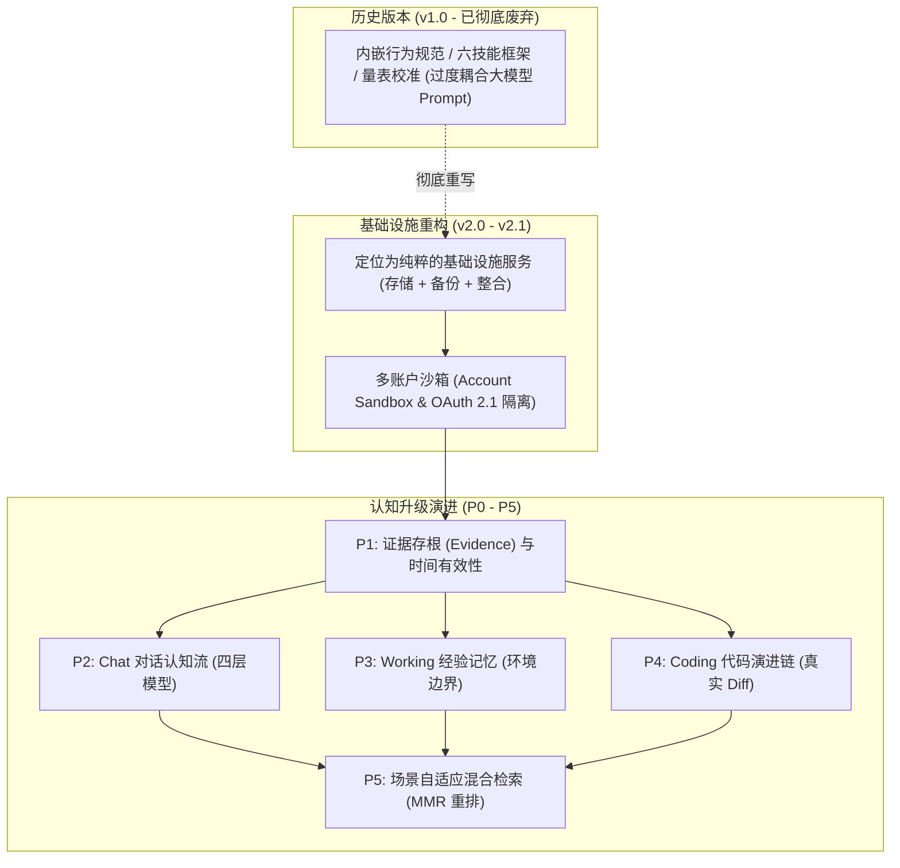
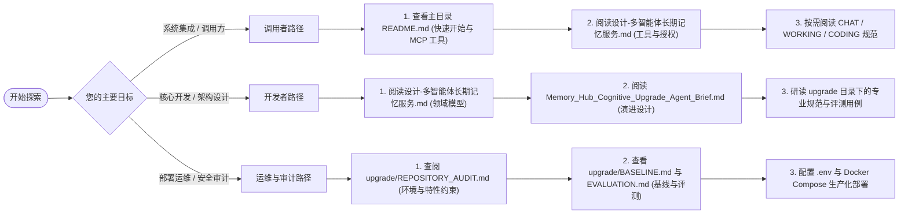

# 记忆中枢 · 文档中枢与架构导航 (Documentation Hub)

> **语言 / Language**：本目录文档仅提供中文版；项目根 README 提供中英双版本
> （[简体中文](https://github.com/orderye/memory-hub/blob/main/README.md) ·
> [English](https://github.com/orderye/memory-hub/blob/main/README.en.md)）。

欢迎查阅 **记忆中枢 (Memory Hub)** 的技术文档库。本目录收录了系统的总体设计规范、认知记忆升级方案、各专业子系统技术协议、基线审计与评测报告。

---

## 1. 文档全景矩阵 (Documentation Matrix)

| 类别 | 文档名称 | 核心主题与范围 | 适用对象 | 状态 |
| :--- | :--- | :--- | :--- | :--- |
| **核心设计** | [`设计-多智能体长期记忆服务.md`](./设计-多智能体长期记忆服务.md) | 记忆中枢总体架构规格书 (v2.1)：两级主体模型、账户沙箱、**原始基础工具合同（18 个）**、OAuth 2.1 规范、备份与整合机制 | 架构师 / 开发者 / 审计者 | **历史设计 (Historical)** —— 工具合同已扩展到 28 个，见根目录 README 的工具清单 |
| **认知升级总纲** | [`Memory_Hub_Cognitive_Upgrade_Agent_Brief.md`](./Memory_Hub_Cognitive_Upgrade_Agent_Brief.md) | 认知升级任务总纲：不可变证据链、时间有效性、Chat/Working/Coding 三大子系统、场景自适应检索实施规范 | 架构师 / Agent 执行者 | **现行规范 (Active)** |
| **工程审计** | [`upgrade/REPOSITORY_AUDIT.md`](./upgrade/REPOSITORY_AUDIT.md) | 仓库代码审计：工程拓扑、空格路径构建约束、依赖特性分析、安全基线盘点 | 运维人员 / 开发者 | **归档报告 (Reference)** |
| **质量基线** | [`upgrade/BASELINE.md`](./upgrade/BASELINE.md) | P0 基线验证：跨账户沙箱隔离断言、授权撤销立即生效、安全备份恢复与幂等性测试 | 测试与安全人员 | **归档报告 (Reference)** |
| **认知子系统** | [`upgrade/CHAT_MEMORY.md`](./upgrade/CHAT_MEMORY.md) | P2 Chat 对话认知流：事实/摘要/偏好/意图四层模型、证据存根、事实演化与版本封堵 | Agent 开发者 / 算法工程师 | **现行规范 (Active)** |
| **认知子系统** | [`upgrade/WORKING_MEMORY.md`](./upgrade/WORKING_MEMORY.md) | P3 Working 经验记忆：任务事实与通用经验解耦、环境边界感知 (`boundary_envs`)、反馈衰减机制 | 自动化 Agent 开发者 | **现行规范 (Active)** |
| **认知子系统** | [`upgrade/CODING_MEMORY.md`](./upgrade/CODING_MEMORY.md) | P4 Coding 代码演进链：真实 Git Diff 捕获、SHA-256 幂等、隐私凭证过滤、Thread 与 Revision 模型 | 代码 Agent / 辅助开发工具 | **现行规范 (Active)** |
| **评测报告** | [`upgrade/EVALUATION.md`](./upgrade/EVALUATION.md) | P5 检索优化与基准评测：**Bench v2（480 文档 / 600 查询，Recall@K / MRR@10 / nDCG@10）**、域外拒绝门禁、业务正确性门禁、阈值标定曲线 | 搜索与评测工程师 | **现行规范 (Active)** |
| **整合升级** | [`upgrade/CONSOLIDATION_AB.md`](./upgrade/CONSOLIDATION_AB.md) | 记忆整合 A/B 双模式：候选发现（纯本地规则 / 向量辅助）、关系分类与自动合并安全门槛、溯源字段、整合专属评测 | 架构师 / 开发者 / 审计者 | **现行规范 (Active)** |
| **发布流程** | [`upgrade/PUSH_PROCESS.md`](./upgrade/PUSH_PROCESS.md) | 双平台（GitHub + CNB）推送规范：身份隔离、patch-id 口径重放、凭证自检、发版与故障排查 | 运维人员 / 贡献者 | **现行规范 (Active)** |
| **轻量化审计** | [`upgrade/LIGHTWEIGHT_AUDIT.md`](./upgrade/LIGHTWEIGHT_AUDIT.md) | 轻量化升级 P0 源码审计：Workspace/Features/Embedding/Retrieval/Consolidation/Cognitive/Storage/Worker/MCP(28 工具)/Backup/CI/迁移逐项结论与缺口清单 | 架构师 / 审计者 | **现行规范 (Active)** |
| **性能基线** | [`upgrade/LIGHTWEIGHT_BASELINE.md`](./upgrade/LIGHTWEIGHT_BASELINE.md) | 优化前后实测对比：二进制体积、启动耗时、空闲 RSS、内存库延迟；明确标注 NOT MEASURED 项（真实 PG / 真实嵌入） | 运维 / 性能工程师 | **现行规范 (Active)** |
| **轻量化执行报告** | [`upgrade/LIGHTWEIGHT_EXECUTION_REPORT.md`](./upgrade/LIGHTWEIGHT_EXECUTION_REPORT.md) | P0–P5 逐阶段实施记录、19 项验收勾选（PASS/BLOCKED/NOT RUN）、已知局限、回滚与复现命令 | 全体 | **现行规范 (Active)** |
| **代码审校** | [`upgrade/CODE_REVIEW.md`](./upgrade/CODE_REVIEW.md) | 2026-10 全量代码审校：三条危险链路、P0–P3 共 32 项精选问题与 34 项轻微项（含位置与修复方向）、分批执行方案与进度跟踪表 | 全体 | **归档报告 (Reference)** |
| **业务集成** | [`创界山智能接入层实施方案.md`](./创界山智能接入层实施方案.md) | 零侵入防腐中间层实施方案：特征指纹探测、虚拟双路召回、数据法规水印与角色视角整合策略 | 外部业务集成人员 | **集成方案 (Active)** |

---

## 1.1 当前口径速查（Agent 必读）

文档里存在**历史版本**。下表是当前实现的真实口径，照着旧文档生成接口会做错：

| 项目 | 历史文档写法 | **当前口径** | 依据 |
| :--- | :--- | :--- | :--- |
| MCP 工具数量 | 18 个（`设计-多智能体长期记忆服务.md`） | **28 个** | 根目录 README「MCP 工具清单」 |
| 评测指标 | MRR@5、6 大测试集（`upgrade/EVALUATION.md` 旧版） | **Recall@1/5/10、MRR@10、nDCG@10**、硬负例违规率、首位误取率、域外误召回率、p50/p95 延迟 | `crates/retrieval/tests/eval_bench.rs` |
| 评测规模 | 6 大测试集 | **Bench v2：480 文档 / 600 查询**，指纹 `9f5b3b075a558371` | 同上 |
| 检索最小分 | 无默认 `min_score` | **默认拒绝阈值 0.65**（`HUB_RETRIEVAL_MIN_SCORE`），无可靠匹配时返回 `no_reliable_match: true` | `crates/common/src/config.rs` |
| 语义能力 | 隐含"向量服务在跑 = 语义可用" | **伪向量嵌入器不参与打分**；`/readyz`、`/capabilities` 显式声明 `semantic.ready` | `crates/mem-core/src/infra.rs` |
| 证据写入 | "原封不动保存" | **写入前脱敏 + 最小化 + 到期清理**；"不可变"指写入后不可悄悄改写 | `crates/mem-core/src/redaction.rs` |
| 整合候选发现 | 默认按向量相似度查重 | **默认 `HUB_CONSOLIDATION_MODE=rules`（纯本地规则整合，embedding 调用恒为 0）**；`hybrid` 需显式开启，且**只有原文/规范化后完全相同**的记忆才允许自动合并 | `docs/upgrade/CONSOLIDATION_AB.md` |

> 旧文档保留是为了看清演进脉络，不是当前接口契约。**接口与验收以根目录 README 与本表为准。**

---

## 2. 系统演进与设计哲学

记忆中枢从立项至今经历了一次根本性的架构重构与一次认知维度的深度演进：

### 核心定位声明
- **只做三件事**：记忆的存取（Store）、备份（Backup）与整合归并（Consolidation）。
- **非侵入与生成解耦**：记忆中枢绝不内嵌任何生成式 Agent 的 Prompt 行为规范或自由推理逻辑，检索返回确切的记忆条目与结构化上下文，由调用方 Agent 自主决定推理方式。
- **确定性与不可篡改**：代码修订必须来自真实 Git Diff、经验必须经受环境边界校验、事实变更采用时间封堵与因果溯源（`supersedes`），拒绝模型幻觉虚构。

---

## 3. 认知记忆系统架构导引 (Cognitive Guide)

认知记忆系统针对 LLM Agent 在长程交互中的痛点（上下文窗口限制、知识陈旧性冲突、经验污染、代码幻觉），构建了三层垂直认知管道：

### 3.1 基础层：不可变证据链与时间图谱
- **不可变证据 (`memory_evidence`)**：在任何模型抽取执行前，先对原始文本/上下文进行持久化（Append-Only）。抽取结果以外键关联证据，保证历史可审计。
- **时间演化模型**：
  - `occurred_at`：事实/事件真实发生的物理时刻；
  - `valid_from` / `valid_until`：事实有效性区间。当事实发生变更（如“老配置被新配置替代”），新事实通过 `supersedes` 关联旧事实，并自动将旧事实的 `valid_until` 封闭为当前时间，避免检索出过时事实导致伪冲突。

### 3.2 Chat 对话认知流
详见 [`upgrade/CHAT_MEMORY.md`](./upgrade/CHAT_MEMORY.md)。
- **四层认知模型**：
  - `Fact`：确定的客观事实与配置，必须挂载证据；
  - `Summary`：阶段性会话上下文摘要；
  - `Pattern`：跨会话稳定的偏好与协作习惯；
  - `Intention`：前瞻计划或待办事项，必须具备明确的 `valid_until`，过期自动失效。
- **审查策略**：支持 `Manual`（生成提案）、`SemiAuto`（置信度高自动入库）、`FullAuto`（全自动）。

### 3.3 Working 经验记忆系统
详见 [`upgrade/WORKING_MEMORY.md`](./upgrade/WORKING_MEMORY.md)。
- **任务与经验严格解耦**：
  - `WorkingFact`：记录单次特定任务的过程、输入、输出与耗时；
  - `Experience`：提炼高度可复用的故障排查模式或解决套路。
- **环境边界感知 (`boundary_envs`)**：
  - 经验显式声明适用环境（例如 `["linux", "k8s"]`）。
  - 在检索时若传入的环境不匹配，系统不仅扣减匹配分，而且显式返回 `env_mismatch = true` 警告，严禁不兼容经验误导执行。
- **反馈闭环**：支持正向反馈（提权）与负向反馈（降权）；当置信度低于阈值时标记为 `Deprecated`，绝不物理硬删除。

### 3.4 Coding 代码演进链
详见 [`upgrade/CODING_MEMORY.md`](./upgrade/CODING_MEMORY.md)。
- **真实 Diff 优先**：严禁模型虚构代码 diff，数据源必须为真实代码提交快照；
- **两级抽象**：`CodingThread`（逻辑任务主题）与 `CodingRevision`（具体文件的真实 Patch）；
- **安全过滤防线**：内置高敏感凭证扫描正则与体积截断保护，禁止私钥、密码和 API Token 进入记忆库。

### 3.5 场景感知混合检索与 MMR
详见 [`upgrade/EVALUATION.md`](./upgrade/EVALUATION.md)。
- **双路并发召回**：CJK Bigram 全文倒排检索 (FTS) 与 pgvector HNSW 余弦相似度并发执行；
- **五维加权打分**：
  $$\text{Score} = w_v \cdot \text{VectorSim} + w_f \cdot \text{FtsScore} + w_r \cdot \text{Recency} + w_w \cdot \text{Weight} + w_c \cdot \text{SceneBoost}$$
- **MMR (Maximal Marginal Relevance) 多样性重排**：在检索前 $K$ 个结果中最大化信息增益，消除上下文窗口中的冗余碎片。

---

## 4. 推荐阅读路径

---

## 5. 文档维护规范与贡献指南

1. **真实代码对齐**：所有文档中出现的接口契约、结构体字段、MCP 工具参数必须与实际 Rust 源码及 Migration 保持 100% 同步，严禁编写未经代码实现的“空中楼阁”；
2. **测试用例对应**：涉及算法与策略变更（如打分公式、MMR 算法、环境感知），必须在 `crates/retrieval/tests/` 或对应 crate 的单元/集成测试中提供可复现的断言验证；
3. **安全与隔离纪律**：任何涉及账户、鉴权和记忆隔离的修改，必须确保满足 Fail-Closed 原则并在 `upgrade/BASELINE.md` 中进行回归记录。
