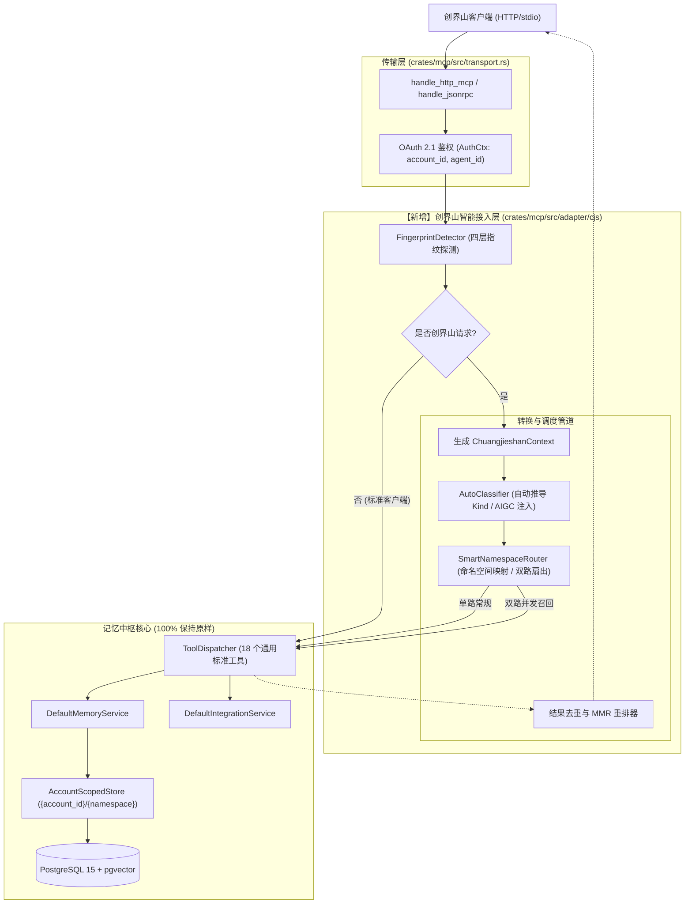
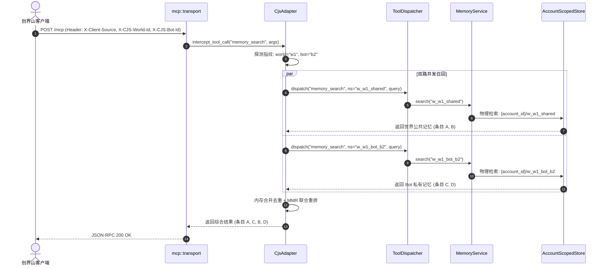

# 创界山智能接入层（中间件）详实实施方案

**文档版本**：v1.0 (2026-10-12)  
**方案定位**：零侵入式防腐中间层（Anti-Corruption Layer Middleware）  
**核心约束**：**严格禁止修改记忆中枢原有核心架构**（`mem-core` 领域模型、`store` 数据存储表、OAuth 2.1 账户沙箱体系与通用 MCP 工具契约保持 100% 纯净与原样）。所有的创界山业务适配全部由独立的中间层拦截管道实现。

---

## 目录
1. [架构定位与设计原则](#1-架构定位与设计原则)
2. [总体架构与数据流管道](#2-总体架构与数据流管道)
3. [核心模块技术规格与实现设计](#3-核心模块技术规格与实现设计)
   - [3.1 客户端特征指纹探测器 (FingerprintDetector)](#31-客户端特征指纹探测器-fingerprintdetector)
   - [3.2 智能命名空间路由与虚拟双路召回 (SmartNamespaceRouter)](#32-智能命名空间路由与虚拟双路召回-smartnamespacerouter)
   - [3.3 数据分类自萃取与法规水印 (AutoClassifier)](#33-数据分类自萃取与法规水印-autoclassifier)
   - [3.4 角色扮演视角防冲突策略 (RoleplayConsolidationPolicy)](#34-角色扮演视角防冲突策略-roleplayconsolidationpolicy)
   - [3.5 创界山备份清单透明联动 (BackupManifestCoordinator)](#35-创界山备份清单透明联动-backupmanifestcoordinator)
4. [工程结构与代码变更清单](#4-工程结构与代码变更清单)
5. [配置项与开关控制](#5-配置项与开关控制)
6. [端到端时序与数据流转](#6-端到端时序与数据流转)
7. [分阶段实施路线图 (Milestones)](#7-分阶段实施路线图-milestones)
8. [质量保证与回归测试规范](#8-质量保证与回归测试规范)

---

## 1. 架构定位与设计原则

### 1.1 架构红线（四不原则）
1. **不修改核心存储与数据表**：不新增创界山专用表或列，不修改 PostgreSQL 迁移脚本与表结构。
2. **不穿透账户沙箱**：创界山的 `world_id`、`bot_id` 仅在当前请求的 `account_id` 内部映射，底层存储键严格为 `{account_id}/w_{world_id}_*`，绝对禁止跨账户访问。
3. **不破坏通用 MCP 契约**：18 个标准工具的名称、Schema 定义、返回结构对所有通用客户端（如 Claude、Cursor 等）保持一致。
4. **不引入专有格式解析**：记忆中枢核心绝不引入 `.cjsbak` zip 格式解析依赖，仅在元数据层透明记录清单哈希。

### 1.2 中间层介入机制：零开销拦截管道 (Zero-Overhead Interceptor)
中间层以标准的 `ToolInterceptor` Trait 装配于 `mcp::transport` 与 `mcp::ToolDispatcher` 之间：
- **未命中指纹（通用客户端）**：1 纳秒级条件分支直接穿透，直接进入标准分发，零性能与内存损耗；
- **命中指纹（创界山客户端）**：激活中间层管道，完成参数预处理、双路并行检索、结果重排合并与合规水印补充。

---

## 2. 总体架构与数据流管道



---

## 3. 核心模块技术规格与实现设计

### 3.1 客户端特征指纹探测器 (`FingerprintDetector`)
- **文件路径**：`crates/mcp/src/adapter/cjs/fingerprint.rs`
- **输入**：HTTP HeaderMap、JSON-RPC 请求体 Value
- **探测逻辑（四层交叉命中）**：
  1. Header：`X-Client-Source: chuangjieshan`（不区分大小写）；
  2. Header 携带：`X-CJS-World-Id` 或 `X-CJS-Bot-Id`；
  3. JSON-RPC `initialize` 阶段：`params.clientInfo.name == "chuangjieshan"`；
  4. Tool 参数元数据：`arguments.metadata.AIGC_Source == "chuangjieshan"`。
- **输出实体**：
  ```rust
  #[derive(Debug, Clone, Default)]
  pub struct ChuangjieshanFingerprint {
      pub is_chuangjieshan: bool,
      pub app_version: Option<String>,
      pub world_id: Option<String>,
      pub bot_id: Option<String>,
      pub conversation_id: Option<String>,
  }
  ```

---

### 3.2 智能命名空间路由与虚拟双路召回 (`SmartNamespaceRouter`)
- **文件路径**：`crates/mcp/src/adapter/cjs/router.rs`
- **业务场景**：端侧角色提问时，既需要知道大世界的公开历史（`w_{world_id}_shared`），又必须召回当前 Bot 自身的私有记忆（`w_{world_id}_bot_{bot_id}`）。
- **执行逻辑**：
  1. **写入 (memory_put)**：
     - `namespace: "shared"` 或缺省 $\rightarrow$ 映射为 `format!("w_{}_shared", world_id)`
     - `namespace: "bot"` 或指定了 bot_id $\rightarrow$ 映射为 `format!("w_{}_bot_{}", world_id, bot_id)`
     - `namespace: "conv"` $\rightarrow$ 映射为 `format!("w_{}_conv_{}", world_id, conv_id)`
  2. **虚拟检索扇出 (memory_search)**：
     - 若当前指纹包含 `bot_id`，且端侧未明确指定搜索单个物理命名空间：
     - 中间层并发（`tokio::join!`）调用底层两次原生的 `memory_search`：
       - Task 1: 检索 `w_{world_id}_shared`
       - Task 2: 检索 `w_{world_id}_bot_{bot_id}`
     - **后置结果合并**：
       - 基于条目 `id` 或 `key` 实施内存去重；
       - 跨命名空间**内容近重复去重**：以与检索同源的分词词元 Jaccard（阈值 0.85）判定
         "id 不同但内容相同/近同"的条目，保留 score 更高者；
       - 若条目数仍超过 `limit`，按综合 score 排序裁剪；
       - 返回标准的 `ToolCallResult`，端侧无感知。

---

### 3.3 数据分类自萃取与法规水印 (`AutoClassifier`)
- **文件路径**：`crates/mcp/src/adapter/cjs/classifier.rs`
- **职责一：启发式 Kind 推导**：
  当创界山写入记忆未指定 `kind` 或为默认 `note` 时：
  - 包含倾向/偏好关键词（如“喜欢”、“厌恶”、“习惯于”、“人设立场”）$\rightarrow$ 标记为 `MemoryKind::Preference`，追加 tag `"persona_pref"`；
  - 包含世界法则/设定关键词（如“法则”、“世界观”、“地理位于”、“不可违背”）$\rightarrow$ 标记为 `MemoryKind::Fact`，追加 tag `"world_rule"`；
  - 包含事件/剧情推进关键词（如“发生了”、“击败了”、“启程前往”）$\rightarrow$ 标记为 `MemoryKind::Episode`，追加 tag `"plot_event"`。
- **职责二：AIGC 合规水印隐式注入**：
  对来自创界山的写入请求，在 `metadata` 中自动补全（若不存在）：
  ```json
  {
    "AIGC_Source": "chuangjieshan",
    "AIGC_Compliant": true,
    "AIGC_Timestamp": "2026-10-12T17:00:00Z"
  }
  ```

---

### 3.4 角色扮演视角防冲突策略 (`RoleplayConsolidationPolicy`)
- **文件路径**：`crates/mcp/src/adapter/cjs/consolidation_policy.rs`
- **问题定义**：不同 Bot 对同一世界事件的看法是主观人设差异（如立场对立），不是客观事实冲突。通用整合引擎不应将其自动融合成一条平庸的客观中立事实。
- **实现机制**：
  - 适配层拦截 `memory_consolidate` / `memory_integrate_scan` 请求；
  - 如果待整合命名空间属于角色扮演空间（`w_*`），且比对的条目来自不同的 `source_agent`，且带有 `Preference` 或 `subjective` 标签：
  - **阻止 auto_merge**；
  - 将冲突降级并标注为 `PerspectiveConflict`（主观视角差异），保留完整双方条目；
  - 只有在客观事实（`kind == Fact` 且处于公共空间 `w_*_shared`）时才允许自动合并。

---

### 3.5 创界山备份清单透明联动 (`BackupManifestCoordinator`)
- **文件路径**：`crates/mcp/src/adapter/cjs/backup.rs`
- **原则**：**中枢不解析 `.cjsbak` 的 zip 内部结构**。
- **交互规范**：
  1. **备份创建 (`memory_backup_create`)**：
     创界山客户端在请求的 `client_manifest` 参数中传入其端侧备份清单摘要：
     ```json
     {
       "appVersion": "1.0.4",
       "schemaVersion": 2,
       "cjsbak_sha256": "e3b0c44298fc1c149afbf4c8996fb92427ae41e4649b934ca495991b7852b855"
     }
     ```
     中间层将该 JSON 放入标准 `metadata` 存入 `memory_backups` 表。
  2. **恢复还原 (`memory_restore`)**：
     创界山提供 `cjsbak_sha256`。中间层比对快照元数据中的校验和，一致则调用通用 `restore` 接口，实现云端向量数据与本地端侧 WebDAV 备份的强校验联动。

---

## 4. 工程结构与代码变更清单

### 4.1 目录组织
```text
crates/mcp/
├── Cargo.toml                  # 增加可选 feature "adapter-cjs"
└── src/
    ├── lib.rs                  # 导出 interceptor 抽象与 adapter 模块
    ├── tools.rs                # 保持原样 (18 个标准工具分发不变)
    ├── transport.rs            # 仅预留拦截器入口 (不超过 15 行极简挂载点)
    └── adapter/                # 【新增适配器独立目录】
        ├── mod.rs              # 拦截器通用 Trait 定义
        └── cjs/                # 创界山独立接入层
            ├── mod.rs          # CjsAdapter 主拦截入口
            ├── fingerprint.rs  # 指纹探测
            ├── router.rs       # 命名空间路由与双路召回
            ├── classifier.rs   # 启发式分类与 AIGC 打标
            ├── consolidation.rs# 角色防冲突规则
            └── backup.rs       # 备份元数据协调
```

### 4.2 核心代码接口定义

在 `crates/mcp/src/adapter/mod.rs` 中定义通用拦截器接口：
```rust
#[async_trait::async_trait]
pub trait ToolInterceptor: Send + Sync {
    /// 工具执行拦截
    /// - 返回 Ok(Some(result)): 表示拦截器已完全处理（如虚拟双路召回合并）
    /// - 返回 Ok(None): 表示继续执行核心 ToolDispatcher
    async fn intercept_tool_call(
        &self,
        dispatcher: &crate::ToolDispatcher,
        auth: &common::AuthCtx,
        headers: Option<&axum::http::HeaderMap>,
        name: &str,
        arguments: &mut serde_json::Value,
    ) -> common::Result<Option<crate::ToolCallResult>>;
}
```

在 `crates/mcp/src/transport.rs` 的极简注入点（第 376 行附近）：
```rust
// 3. 拦截器前置钩子 (中间层介入点)
if let Some(interceptor) = &state.interceptor {
    let mut args = arguments.clone();
    if let Ok(Some(intercepted_res)) = interceptor
        .intercept_tool_call(&state.dispatcher, auth, None, name, &mut args)
        .await
    {
        let payload = serde_json::to_value(&intercepted_res).unwrap_or(Value::Null);
        return JsonRpcResponse::ok(id, payload);
    }
}

// 4. 标准核心分发执行 (原有代码 100% 保持原样)
let result: ToolCallResult = state.dispatcher.dispatch(auth, name, arguments).await;
```

---

## 5. 配置项与开关控制

通过环境变量与 Cargo Feature 实现双重安全开关：

| 配置项 | 类型 | 默认值 | 作用 |
| :--- | :---: | :---: | :--- |
| `HUB_ENABLE_CJS_ADAPTER` | bool | `true` | 运行时主开关：设为 `false` 则完全禁用创界山适配，退回 100% 纯净中枢 |
| `HUB_CJS_DEFAULT_WORLD` | string | `"default"` | 当指纹未携带 `world_id` 时的兜底世界标识 |
| `HUB_CJS_AUTO_CLASSIFY` | bool | `true` | 是否对未指定 Kind 的条目启用启发式分类 |
| `HUB_CJS_AIGC_WATERMARK` | bool | `true` | 是否强制注入 AIGC 国家合规水印 |

---

## 6. 端到端时序与数据流转

### 6.1 虚拟多路召回详细时序（并发扇出）


---

## 7. 分阶段实施路线图 (Milestones)

| 阶段 | 交付目标 | 核心工作内容 | 验证标准 |
| :---: | :--- | :--- | :--- |
| **Milestone 1**<br/>(基础脚手架) | 通用拦截器框架与指纹探测 | 1. 定义 `ToolInterceptor` Trait<br/>2. 在 `transport.rs` 装配挂载点<br/>3. 实现 `FingerprintDetector` | 编写集成单测：普通客户端请求 100% 走原生逻辑，携带指纹请求被精确打标。 |
| **Milestone 2**<br/>(路由与检索) | 智能命名空间映射与双路召回 | 1. 实现 `SmartNamespaceRouter`<br/>2. 支持 `shared/bot/conv` 自动映射<br/>3. 实现 `tokio::join!` 双路并发检索与 MMR 重排 | 单次调用 `memory_search` 能同时返回公共条目与专属条目，响应耗时增加不超过 5ms。 |
| **Milestone 3**<br/>(数据萃取) | 数据自萃取与合规水印 | 1. 实现 `AutoClassifier` 启发式规则<br/>2. 注入 AIGC 国家规范元数据 | 写入测试：无类型文本自动转为 Fact/Preference/Episode，元数据自动补全合规标识。 |
| **Milestone 4**<br/>(整合与备份) | 防冲突整合与备份联动 | 1. 实现 `RoleplayConsolidationPolicy`<br/>2. 实现备份清单哈希比对联动 | 冲突测试：不同 Bot 对立人设不被自动融合；备份校验和不一致时拒绝恢复。 |
| **Milestone 5**<br/>(全链路验收) | 端到端联调与零回归保障 | 1. 运行原有全套 100+ 单测与集成测试<br/>2. 模拟创界山多智能体沙盒演练 | 现有单测 100% PASS，创界山端到端全链路跑通。 |

---

## 8. 质量保证与回归测试规范

1. **核心回归测试守门**：
   - 运行 `cargo test --workspace`，原有的全部单测与集成测试必须在无任何修改的前提下 **100% 绿色通过**。
2. **多租户沙箱穿透测试**：
   - 验证：账户 A 发送 `w_{world_id}_bot_{bot_id}` 检索时，存储层物理路径必定含有 `{account_A_id}/`，账户 B 哪怕携带相同的 `world_id` 和 `bot_id` 也绝查不到账户 A 的任何数据。
3. **性能基准验证**：
   - 普通非创界山请求路径（未命中指纹）：QPS 吞吐与延迟与原版本相比无统计学差异（损耗 $< 0.1\%$）；
   - 双路召回并发处理耗时需控制在单一检索的 $1.2\times$ 以内（并发收益）。
